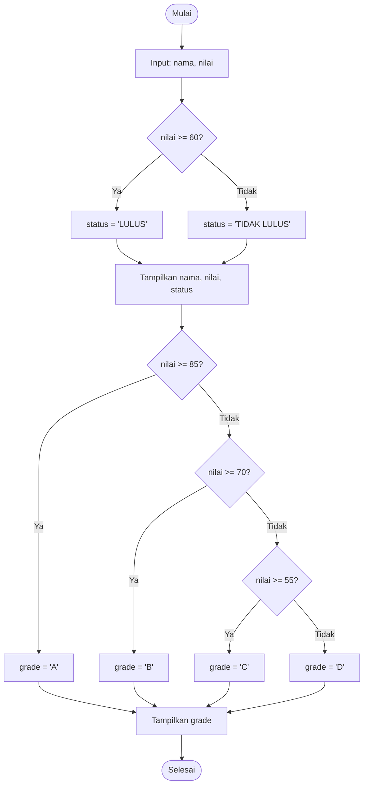

# Laporan Praktikum Week 1 — Variabel, Tipe Data, dan Percabangan

## Identitas Diri
```py
Nama  = "Dendra De Tama"
NIM   = 108052600034
Kelas = "SS1SI-50-REG-01"
Dosen = "Adzanil Rachmadhi Putra"
```

---

## Deskripsi Program

Praktikum Week 1 mencakup pengenalan dasar pemrograman Python, meliputi tiga topik utama: **deklarasi variabel dan tipe data**, **operasi input/output**, dan **struktur kontrol percabangan** (`if`, `elif`, `else`). Program-program yang dibuat pada sesi ini terdiri dari latihan terbimbing (`latihan1.py` s.d. `latihan4.py`), studi kasus evaluasi akademik (`studi_kasus.py`), serta lima soal tugas mandiri (`task1.py` s.d. `task5.py`).

Secara keseluruhan, program-program ini mendemonstrasikan cara menyimpan data dalam variabel bertipe `str`, `int`, `float`, dan `bool`; membaca masukan pengguna melalui fungsi `input()`; menampilkan keluaran dengan `print()`; serta membuat keputusan bercabang berdasarkan kondisi relasional dan aritmatika modulo.

---

## Dekomposisi Masalah

| Sub-Masalah | Plan Pemrograman | Letak di Program | Keterangan |
| :--- | :--- | :--- | :--- |
| **Deklarasi Variabel Multi-Tipe** | Inisialisasi Variabel | `latihan1.py`, baris 1–4 | Mendeklarasikan variabel `str`, `int`, `float`, dan `bool` sekaligus. |
| **Inspeksi Tipe Data** | Pemanggilan Fungsi Bawaan | `latihan1.py`, baris 7–10 | Menggunakan `type()` untuk memverifikasi tipe setiap variabel. |
| **Pembacaan Masukan Pengguna** | *Input Conversion* (Konversi Masukan) | `latihan2.py`, baris 1–2 | Mengonversi string mentah dari `input()` ke `int` dengan casting eksplisit. |
| **Kalkulasi dan Proyeksi Nilai** | Operasi Aritmatika | `latihan2.py`, baris 4–5 | Menghitung `umur + 1` untuk menampilkan usia tahun depan. |
| **Percabangan Genap/Ganjil** | *Binary Branching* (Percabangan Biner) | `latihan3.py`, baris 3–6 | Menggunakan operator modulo `%` dan `if-else` untuk klasifikasi bilangan. |
| **Percabangan Multi-Kategori Nilai** | *Multi-way Branching* (Percabangan Berantai) | `latihan4.py`, baris 3–10 | Rantai `if-elif-elif-else` untuk mengklasifikasikan nilai ke dalam empat kategori. |
| **Penentuan Status Kelulusan** | *Binary Branching* + *Multi-way Branching* | `studi_kasus.py`, baris 4–18 | Dua blok percabangan terpisah: pertama menentukan LULUS/TIDAK LULUS, lalu grade A–D. |
| **Input Profil & Output Terformat** | *f-string Formatting* | `studi_kasus.py`, baris 9, 20 | Memanfaatkan f-string untuk menyematkan variabel dalam teks keluaran. |
| **Kalkulator Empat Operasi** | *Multi-way Branching* + *Zero Guard* | `task2.py`, baris 7–10 | Menerapkan percabangan untuk setiap operator; penjaga `angka2 != 0` mencegah galat pembagian nol. |
| **Klasifikasi Bilangan (Task)** | *Binary Branching* | `task3.py`, baris 3–6 | Implementasi mandiri deteksi genap/ganjil menggunakan `angka % 2`. |
| **Konversi Nilai ke Huruf (Task)** | *Multi-way Branching* | `task4.py`, baris 3–10 | Rantai `if-elif-else` dengan ambang batas 90, 80, 70 untuk grade A–D. |
| **Kalkulator dengan Pemilihan Operator** | *Multi-way Branching* + *Inline Conditional* | `task5.py`, baris 5–14 | Pengguna memilih operator; pembagian dengan nol ditangani via ekspresi kondisional satu baris. |

---

## Flowchart & Pseudocode

### Flowchart Studi Kasus (`studi_kasus.py`)



---

### Pseudocode `task2.py` (Kalkulator Empat Operasi)

```text
ALGORITMA KalkulatorEmpat
MASUKAN : angka1, angka2 : INTEGER
KELUARAN: hasil operasi aritmatika

PROSES:
    BACA angka1
    BACA angka2

    TAMPILKAN "Hasil Penjumlahan:" angka1 + angka2
    TAMPILKAN "Hasil Pengurangan:" angka1 - angka2
    TAMPILKAN "Hasil Perkalian:"   angka1 * angka2

    JIKA angka2 != 0 MAKA
        TAMPILKAN "Hasil Pembagian:" angka1 / angka2
    SELAIN ITU
        TAMPILKAN "Hasil Pembagian: Tidak dapat membagi dengan nol"
    AKHIR JIKA
SELESAI
```

---

### Pseudocode `task5.py` (Kalkulator Pilihan Operator)

```text
ALGORITMA KalkulatorOperator
MASUKAN : angka1, operator, angka2 : INTEGER, STRING, INTEGER
KELUARAN: hasil operasi sesuai pilihan operator

PROSES:
    BACA angka1
    BACA operator
    BACA angka2

    JIKA operator = "+" MAKA
        TAMPILKAN angka1 + angka2
    SELAIN ITU JIKA operator = "-" MAKA
        TAMPILKAN angka1 - angka2
    SELAIN ITU JIKA operator = "*" MAKA
        TAMPILKAN angka1 * angka2
    SELAIN ITU JIKA operator = "/" MAKA
        JIKA angka2 != 0 MAKA
            TAMPILKAN angka1 / angka2
        SELAIN ITU
            TAMPILKAN "Tidak dapat membagi dengan nol"
        AKHIR JIKA
    SELAIN ITU
        TAMPILKAN "Operator yang Anda masukkan salah"
    AKHIR JIKA
SELESAI
```

---

## Tabel Penelusuran (Trace Table)

Penelusuran manual terhadap `studi_kasus.py` dengan dua skenario representatif:
- **Skenario 1**: nama = "Budi", nilai = 78
- **Skenario 2**: nama = "Ani", nilai = 52

| No | Variabel | Skenario 1 (nilai = 78) | Skenario 2 (nilai = 52) | Status |
| :---: | :--- | :--- | :--- | :---: |
| 1 | `nama` | "Budi" | "Ani" | Sesuai |
| 2 | `nilai` | 78 | 52 | Sesuai |
| 3 | Kondisi `nilai >= 60` | True → `status = "LULUS"` | False → `status = "TIDAK LULUS"` | Sesuai |
| 4 | Kondisi `nilai >= 85` | False | False | Sesuai |
| 5 | Kondisi `nilai >= 70` | True → `grade = "B"` | False | Sesuai |
| 6 | Kondisi `nilai >= 55` | - (sudah terpenuhi) | False → `grade = "D"` | Sesuai |
| 7 | `status` | "LULUS" | "TIDAK LULUS" | Sesuai |
| 8 | `grade` | "B" | "D" | Sesuai |
| 9 | Output baris 9 | "Budi dengan nilai akhir 78 dinyatakan LULUS" | "Ani dengan nilai akhir 52 dinyatakan TIDAK LULUS" | Sesuai |
| 10 | Output baris 20 | "Grade: B" | "Grade: D" | Sesuai |

---

## Tabel Kasus Uji

| No | Program | Kategori | Masukan (*Input*) | Hasil yang Diharapkan (*Expected*) | Hasil Program (*Actual*) | Status |
| :---: | :--- | :--- | :--- | :--- | :--- | :---: |
| 1 | `latihan3.py` | **Normal** | angka = 4 | "4 adalah bilangan genap" | Sesuai harapan | PASS |
| 2 | `latihan3.py` | **Normal** | angka = 7 | "7 adalah bilangan ganjil" | Sesuai harapan | PASS |
| 3 | `latihan4.py` | **Normal** | nilai = 90 | Kategori nilai kamu: A | Sesuai harapan | PASS |
| 4 | `latihan4.py` | **Normal** | nilai = 72 | Kategori nilai kamu: B | Sesuai harapan | PASS |
| 5 | `latihan4.py` | **Normal** | nilai = 60 | Kategori nilai kamu: C | Sesuai harapan | PASS |
| 6 | `latihan4.py` | **Batas** | nilai = 85 | Kategori nilai kamu: A (tepat di batas bawah A) | Sesuai harapan | PASS |
| 7 | `studi_kasus.py` | **Batas** | nilai = 60 | LULUS, Grade C | Sesuai harapan | PASS |
| 8 | `studi_kasus.py` | **Batas** | nilai = 59 | TIDAK LULUS, Grade D | Sesuai harapan | PASS |
| 9 | `task2.py` | **Tidak Valid** | angka1 = 10, angka2 = 0 | "Hasil Pembagian: Tidak dapat membagi dengan nol" | Sesuai harapan | PASS |
| 10 | `task5.py` | **Tidak Valid** | operator = "%" | "Operator yang Anda masukkan salah" | Sesuai harapan | PASS |
| 11 | `task4.py` | **Batas** | nilai = 90 | "Nilai Anda adalah A" | Sesuai harapan | PASS |
| 12 | `task4.py` | **Batas** | nilai = 69 | "Nilai Anda adalah D" | Sesuai harapan | PASS |

---

## Catatan Galat

1. **Galat Sintaks (*Syntax Error*)**:
   - *Penyebab*: Lupa menambahkan tanda titik dua (`:`) setelah pernyataan `if`, `elif`, atau `else`.
   - *Cara Menemukan*: Python langsung memunculkan `SyntaxError: expected ':'` pada baris yang bermasalah saat program dijalankan.
   - *Perbaikan*: Selalu memastikan setiap pernyataan blok kontrol (`if`, `elif`, `else`, `while`, `for`) diakhiri dengan `:`.

2. **Galat Runtime (*Runtime Error*)**:
   - *Penyebab*: Melakukan operasi pembagian `angka1 / angka2` tanpa memeriksa terlebih dahulu apakah `angka2` bernilai nol, sehingga memicu `ZeroDivisionError`.
   - *Cara Menemukan*: Program berjalan normal hingga saat pengguna memasukkan angka kedua bernilai `0`, kemudian *crash* dengan pesan `ZeroDivisionError: division by zero`.
   - *Perbaikan*: Menambahkan penjaga kondisi `if angka2 != 0:` sebelum operasi pembagian, seperti yang diterapkan di `task2.py` baris 7.

3. **Galat Logika (*Logic Error*)**:
   - *Penyebab*: Urutan kondisi `elif` yang terbalik pada percabangan nilai. Misalnya, menulis `elif nilai >= 55:` sebelum `elif nilai >= 70:` akan menyebabkan semua nilai di atas 55 langsung masuk kategori C meskipun seharusnya B atau A.
   - *Cara Menemukan*: Program berjalan tanpa error, namun keluaran tidak sesuai — nilai 80 menghasilkan kategori C, bukan B. Terdeteksi melalui pengujian manual dengan nilai uji representatif.
   - *Perbaikan*: Menyusun kondisi `elif` dari ambang batas **tertinggi ke terendah** agar evaluasi dilakukan secara berurutan dan benar.

---

## Refleksi

Konsep yang paling mudah dipahami pada praktikum ini adalah deklarasi variabel dan penggunaan fungsi `print()`, karena Python memiliki sintaks yang ringkas dan natural. Tantangan terbesar muncul saat merancang urutan kondisi `if-elif-else` yang benar — pemahaman bahwa Python mengevaluasi kondisi secara berurutan dari atas ke bawah sangat krusial agar logika percabangan bekerja sesuai harapan.

Selain itu, saya menyadari pentingnya *type casting* eksplisit saat menggunakan `input()`, karena fungsi tersebut selalu mengembalikan tipe `str` meskipun pengguna memasukkan angka. Tanpa konversi `int()` atau `float()`, operasi aritmatika akan gagal dengan `TypeError`.

Batasan yang saya temukan pada program-program ini adalah belum adanya validasi masukan (*input validation*) — misalnya pada `task4.py`, jika pengguna memasukkan nilai di luar rentang 0–100 atau memasukkan teks bukan angka, program akan menghasilkan perilaku yang tidak terduga. Hal ini akan menjadi bahan perbaikan pada praktikum berikutnya.

---

## Pengungkapan Penggunaan AI

- **Bagian yang Dibantu AI**:
  - Perumusan penjelasan konsep *type casting* dan perbedaan antara `int()`, `float()`, dan `str()`.
  - Penyusunan format tabel dekomposisi masalah dan tabel kasus uji.
  - Penulisan pseudocode dengan konvensi bahasa Indonesia yang konsisten.
- **Saran AI yang Dipakai**:
  - Penggunaan f-string (`f"..."`) pada `studi_kasus.py` untuk memformat keluaran yang lebih rapi dibandingkan concatenation string biasa.
  - Penanganan pembagian dengan nol menggunakan ekspresi kondisional satu baris (*inline conditional*): `angka1 / angka2 if angka2 != 0 else "Tidak dapat membagi dengan nol"`.
- **Saran AI yang Ditolak & Alasannya**:
  - Penggunaan modul `math` untuk operasi matematika, ditolak karena materi praktikum Week 1 berfokus pada operator aritmatika dasar Python tanpa dependensi pustaka eksternal.
  - Penggunaan `match-case` (Python 3.10+) sebagai pengganti rantai `if-elif`, ditolak karena pedoman praktikum menekankan pemahaman struktur `if-elif-else` yang lebih fundamental dan kompatibel dengan semua versi Python.
