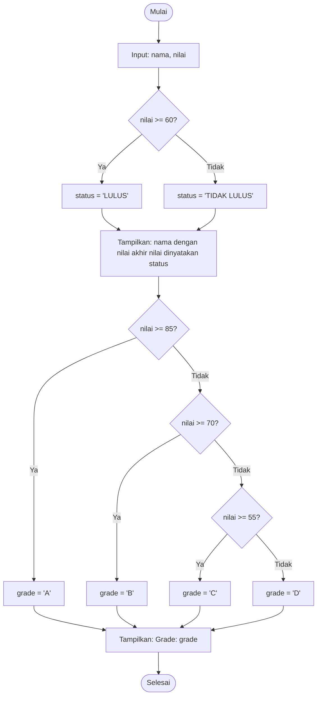

# Laporan Praktikum Week 1 — Variabel, Tipe Data, dan Percabangan

## Identitas Diri
```py
Nama  = "Dendra De Tama"
NIM   = 108052600034
Kelas = "SS1SI-50-REG-01"
Dosen = "Adzanil Rachmadhi Putra"
```

---

## Deskripsi Program

Praktikum Week 1 berfokus pada pengenalan dasar pemrograman Python 3 sesuai Modul Praktikum 1 (*Variabel, Tipe Data, dan Struktur Kontrol Percabangan*). Topik utama mencakup **deklarasi variabel**, **tipe data dasar** (`str`, `int`, `float`, `bool`), **fungsi tipe** (`type()`), **pembacaan masukan dan konversi tipe** (`input()`, `int()`, `float()`), serta **struktur kontrol percabangan** (`if`, `elif`, `else`).

Kumpulan program yang dikembangkan pada praktikum ini terdiri dari:
1. **Latihan Terbimbing**:
   - `latihan1.py`: Deklarasi variabel multi-tipe dan verifikasi tipe data menggunakan fungsi bawaan `type()`.
   - `latihan2.py`: Pembacaan masukan string dan numerik via `input()` serta casting eksplisit `int()` untuk kalkulasi aritmatika.
   - `latihan3.py`: Struktur kontrol percabangan biner (`if-else`) dan operator modulo `%` untuk klasifikasi bilangan ganjil atau genap.
   - `latihan4.py`: Struktur kontrol percabangan berantai (`if-elif-else`) untuk menentukan kategori nilai ujian (A, B, C, D).
2. **Studi Kasus (`studi_kasus.py`)**:
   - Program Cek Kelulusan Mahasiswa yang memproses masukan nama dan nilai akhir, menentukan status kelulusan ($\ge 60$ Lulus, $< 60$ Tidak Lulus), serta mengimplementasikan tantangan tambahan berupa penentuan grade huruf (A/B/C/D).

---

## Dekomposisi Masalah

| Sub-Masalah | Plan Pemrograman | Letak di Program | Keterangan |
| :--- | :--- | :--- | :--- |
| **Deklarasi Variabel Multi-Tipe** | Inisialisasi Variabel | `latihan1.py`, baris 1–4 | Mendeklarasikan variabel `str`, `int`, `float`, dan `bool` secara implisit tanpa penentuan tipe statis. |
| **Inspeksi Tipe Data** | Pemanggilan Fungsi Bawaan | `latihan1.py`, baris 7–10 | Menggunakan `type()` untuk memverifikasi kelas tipe data dari masing-masing variabel. |
| **Pembacaan Masukan Pengguna** | *Input Conversion* (Konversi Masukan) | `latihan2.py`, baris 1–2 | Mengonversi string mentah hasil `input()` ke bilangan bulat dengan fungsi `int()`. |
| **Kalkulasi dan Proyeksi Nilai** | Operasi Aritmatika | `latihan2.py`, baris 5 | Menghitung `umur + 1` untuk menampilkan proyeksi usia pengguna tahun depan. |
| **Percabangan Genap/Ganjil** | *Binary Branching* (Percabangan Biner) | `latihan3.py`, baris 3–6 | Menggunakan operator modulo `% 2 == 0` dan struktur `if-else` untuk deteksi paritas angka. |
| **Percabangan Multi-Kategori Nilai** | *Multi-way Branching* (Percabangan Berantai) | `latihan4.py`, baris 3–10 | Evaluasi berurutan ambang batas nilai ($\ge 85, \ge 70, \ge 55$, atau default) untuk kategori A–D. |
| **Penentuan Status Kelulusan** | *Binary Branching* | `studi_kasus.py`, baris 4–7 | Mengevaluasi syarat nilai $\ge 60$ untuk menentukan status `LULUS` atau `TIDAK LULUS`. |
| **Output Terformat Mahasiswa** | *f-string Formatting* | `studi_kasus.py`, baris 9 | Menyusun keluaran gabungan nama, nilai akhir, dan status kelulusan dalam satu baris kalimat. |
| **Penentuan Grade Akademik (Tantangan)** | *Multi-way Branching* | `studi_kasus.py`, baris 11–18 | Mengelompokkan grade huruf mahasiswa (A/B/C/D) sesuai kriteria Latihan 4. |

---

## Flowchart & Pseudocode

### Flowchart Studi Kasus (`studi_kasus.py`)



---

### Pseudocode `studi_kasus.py` (Cek Kelulusan Mahasiswa)

```text
ALGORITMA CekKelulusanMahasiswa
MASUKAN : nama : STRING, nilai : INTEGER
KELUARAN: status kelulusan dan grade huruf

PROSES:
    BACA nama
    BACA nilai

    JIKA nilai >= 60 MAKA
        status <- "LULUS"
    SELAIN ITU
        status <- "TIDAK LULUS"
    AKHIR JIKA

    TAMPILKAN nama, "dengan nilai akhir", nilai, "dinyatakan", status

    JIKA nilai >= 85 MAKA
        grade <- "A"
    SELAIN ITU JIKA nilai >= 70 MAKA
        grade <- "B"
    SELAIN ITU JIKA nilai >= 55 MAKA
        grade <- "C"
    SELAIN ITU
        grade <- "D"
    AKHIR JIKA

    TAMPILKAN "Grade:", grade
SELESAI
```

---

### Pseudocode `latihan4.py` (Kategori Nilai Ujian)

```text
ALGORITMA KategoriNilaiUjian
MASUKAN : nilai : INTEGER
KELUARAN: kategori nilai huruf

PROSES:
    BACA nilai

    JIKA nilai >= 85 MAKA
        kategori <- "A"
    SELAIN ITU JIKA nilai >= 70 MAKA
        kategori <- "B"
    SELAIN ITU JIKA nilai >= 55 MAKA
        kategori <- "C"
    SELAIN ITU
        kategori <- "D"
    AKHIR JIKA

    TAMPILKAN "Kategori nilai kamu:", kategori
SELESAI
```

---

## Tabel Penelusuran (Trace Table)

Penelusuran manual terhadap `studi_kasus.py` dengan dua skenario representatif:
- **Skenario 1**: nama = "Sinta", nilai = 72 (sesuai contoh di modul)
- **Skenario 2**: nama = "Budi", nilai = 52

| No | Variabel / Langkah | Skenario 1 (nama = "Sinta", nilai = 72) | Skenario 2 (nama = "Budi", nilai = 52) | Status |
| :---: | :--- | :--- | :--- | :---: |
| 1 | `nama` | "Sinta" | "Budi" | Sesuai |
| 2 | `nilai` | 72 | 52 | Sesuai |
| 3 | Evaluasi `nilai >= 60` | True ($72 \ge 60$) → `status = "LULUS"` | False ($52 < 60$) → `status = "TIDAK LULUS"` | Sesuai |
| 4 | Output Status | "Sinta dengan nilai akhir 72 dinyatakan LULUS" | "Budi dengan nilai akhir 52 dinyatakan TIDAK LULUS" | Sesuai |
| 5 | Evaluasi `nilai >= 85` | False ($72 < 85$) | False ($52 < 85$) | Sesuai |
| 6 | Evaluasi `nilai >= 70` | True ($72 \ge 70$) → `grade = "B"` | False ($52 < 70$) | Sesuai |
| 7 | Evaluasi `nilai >= 55` | - *(dilewati karena kondisi sebelumnya True)* | False ($52 < 55$) | Sesuai |
| 8 | Blok `else` Grade | - | `grade = "D"` | Sesuai |
| 9 | Output Grade | "Grade: B" | "Grade: D" | Sesuai |

---

## Tabel Kasus Uji

| No | Program | Kategori Uji | Masukan (*Input*) | Hasil yang Diharapkan (*Expected*) | Hasil Program (*Actual*) | Status |
| :---: | :--- | :--- | :--- | :--- | :--- | :---: |
| 1 | `latihan1.py` | **Normal** | *(Tanpa input)* | Variabel terdefinisi & output 4 baris tipe data (`str`, `int`, `float`, `bool`) | Sesuai output modul | PASS |
| 2 | `latihan2.py` | **Normal** | nama = "Dimas", umur = 19 | Halo, Dimas<br>Tahun depan usiamu 20 tahun | Sesuai output modul | PASS |
| 3 | `latihan3.py` | **Normal** | angka = 12 | 12 adalah bilangan genap | Sesuai output modul | PASS |
| 4 | `latihan3.py` | **Normal** | angka = 7 | 7 adalah bilangan ganjil | Sesuai harapan | PASS |
| 5 | `latihan4.py` | **Batas (A)** | nilai = 85 | Kategori nilai kamu: A | Sesuai harapan | PASS |
| 6 | `latihan4.py` | **Normal (B)**| nilai = 78 | Kategori nilai kamu: B | Sesuai output modul | PASS |
| 7 | `latihan4.py` | **Batas (B)** | nilai = 70 | Kategori nilai kamu: B | Sesuai harapan | PASS |
| 8 | `latihan4.py` | **Batas (C)** | nilai = 55 | Kategori nilai kamu: C | Sesuai harapan | PASS |
| 9 | `latihan4.py` | **Normal (D)**| nilai = 40 | Kategori nilai kamu: D | Sesuai harapan | PASS |
| 10 | `studi_kasus.py` | **Normal** | nama = "Sinta", nilai = 72 | Sinta dengan nilai akhir 72 dinyatakan LULUS<br>Grade: B | Sesuai output modul | PASS |
| 11 | `studi_kasus.py` | **Batas Lulus**| nama = "Andi", nilai = 60 | Andi dengan nilai akhir 60 dinyatakan LULUS<br>Grade: C | Sesuai harapan | PASS |
| 12 | `studi_kasus.py` | **Batas Gagal**| nama = "Rina", nilai = 59 | Rina dengan nilai akhir 59 dinyatakan TIDAK LULUS<br>Grade: C | Sesuai harapan | PASS |

---

## Catatan Galat

1. **Galat Sintaks (*Syntax Error*)**:
   - *Penyebab*: Lupa menyertakan tanda titik dua (`:`) di akhir baris pernyataan `if`, `elif`, atau `else`.
   - *Cara Menemukan*: Interpreter Python menampilkan pesan `SyntaxError: expected ':'` tepat pada nomor baris blok kondisi yang bersangkutan.
   - *Perbaikan*: Menambahkan tanda titik dua (`:`) pada setiap akhir baris struktur kontrol percabangan.

2. **Galat Tipe Data Runtime (*TypeError / ValueError*)**:
   - *Penyebab*: Mencoba mengoperasikan masukan angka tanpa melakukan konversi tipe terlebih dahulu (misal: `"19" + 1`), atau memasukkan karakter teks non-angka ke dalam fungsi `int()`.
   - *Cara Menemukan*: Timbul galat `TypeError: can only concatenate str (not "int") to str` saat operasi aritmatika, atau `ValueError: invalid literal for int() with base 10` jika input tidak valid.
   - *Perbaikan*: Menggunakan konversi tipe eksplisit `int(input(...))` atau `float(input(...))` sesuai instruksi pada Latihan 2.

3. **Galat Logika (*Logic Error*)**:
   - *Penyebab*: Pengurutan rentang kondisi `elif` yang salah (misalnya meletakkan pemeriksaan $\ge 55$ sebelum $\ge 85$). Akibatnya, nilai tinggi seperti 90 akan terhenti di kondisi pertama yang bernilai True dan menerima kategori C.
   - *Cara Menemukan*: Program berjalan lancar tanpa pesan kesalahan teknis, namun kategori nilai yang dicetak tidak sesuai kriteria penilaian.
   - *Perbaikan*: Menyusun urutan evaluasi kondisi secara teratur dari batas nilai tertinggi menuju batas nilai terendah (`>= 85`, `>= 70`, `>= 55`, lalu `else`).

---

## Refleksi

Konsep yang paling mudah dipahami pada praktikum ini adalah pembuatan variabel dan penggunaan fungsi bawaan `print()` serta `type()`, karena sintaks Python yang intuitif dan bertipe dinamis memudahkan pendefinisian data tanpa deklarasi tipe secara eksplisit.

Tantangan utama yang dihadapi adalah memahami alur evaluasi percabangan bersyarat (`if-elif-else`) yang berjalan runtut dari atas ke bawah. Urutan kondisi sangat menentukan kebenaran logika program, terutama pada klasifikasi nilai bertingkat. Selain itu, pentingnya *type casting* eksplisit pada masukan `input()` menjadi pemahaman mendasar agar operasi aritmatika dan evaluasi perbandingan angka dapat dieksekusi dengan tepat tanpa galat tipe.

Sebagai pengembangan lebih lanjut, program dapat dilengkapi penanganan validasi input (*exception handling* `try-except`) agar program tidak berhenti mendadak saat pengguna memasukkan karakter yang bukan angka.

---

## Pengungkapan Penggunaan AI

- **Bagian yang Dibantu AI**:
  - Penyusunan format dokumentasi laporan praktikum dan tabel kasus uji komprehensif.
  - Perancangan diagram alir (*flowchart*) berbasis sintaks Mermaid dan pseudocode standar.
  - Penataan gaya kalimat penjelasan teori dan catatan galat teknis.
- **Saran AI yang Dipakai**:
  - Penerapan format f-string (`f"{nama}..."`) pada `studi_kasus.py` agar penggabungan teks string dan nilai variabel lebih rapi dan efisien.
  - Penstrukturan urutan uji kasus batas (*boundary value analysis*) untuk menguji nilai tepat pada ambang batas kelulusan dan pergantian kategori grade.
- **Saran AI yang Ditolak & Alasannya**:
  - Penambahan modul `sys` atau pustaka validasi eksternal, ditolak karena cakupan Modul Praktikum 1 difokuskan pada sintaks dasar bawaan Python murni (*vanilla Python*).
  - Penggunaan struktur `match-case`, ditolak karena materi modul menekankan penguasaan logika dasar percabangan `if-elif-else`.
