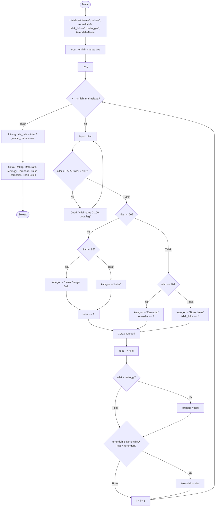

# Laporan Praktikum Week 2 — Percabangan Bertingkat dan Perulangan Dasar

## Identitas Diri
```py
Nama  = "Dendra De Tama"
NIM   = 108052600034
Kelas = "SS1SI-50-REG-01"
Dosen = "Adzanil Rachmadhi Putra"
```

---

## Deskripsi Program

Praktikum Week 2 berfokus pada penguasaan struktur kontrol tingkat lanjut di Python, mencakup **percabangan bertingkat (*nested if*)**, **perulangan terhitung (*for loop* dengan fungsi `range()`*)**, **perulangan bersyarat (*while loop*)**, serta **perintah pengontrol aliran perulangan (`break` dan `continue`)**.

Kumpulan program yang dikembangkan pada praktikum ini terdiri dari:
1. **Latihan Terbimbing**:
   - `latihan1.py`: Penerapan *nested if* untuk validasi usia dan kepemilikan kartu pelajar pada pembelian tiket bioskop.
   - `latihan2.py`: Penggunaan perulangan `for` dan fungsi `range()` untuk enumerasi angka serta pembuatan tabel perkalian matematika.
   - `latihan3.py`: Penerapan perulangan `while` akumulatif berbasis *sentinel value* (berhenti ketika input angka bernilai 0).
   - `latihan4.py`: Simulasi kendali loncatan perulangan menggunakan kata kunci `break` (terminasi paksa) dan `continue` (pintas iterasi).
2. **Studi Kasus (`studi_kasus.py`)**:
   - Program rekapitulasi nilai kuis kelas terintegrasi yang memadukan `for loop` (iterasi mahasiswa), `while loop` (*input guard* validasi rentang nilai 0–100), *nested if* (klasifikasi kategori nilai bertingkat: Lulus Sangat Baik, Lulus, Remedial, Tidak Lulus), serta pelacakan nilai ekstrem (tertinggi dan terendah) dan kalkulasi rata-rata kelas.
3. **Tugas Mandiri (`task1.py` – `task5.py`)**:
   - `task1.py`: Variasi seleksi tiket bioskop dengan metode penanganan string case-insensitive (`.lower()`).
   - `task2.py`: Perhitungan total harga kelipatan barang belanjaan berbasis perulangan `for`.
   - `task3.py`: Implementasi *step parameter* pada `range()` dan perulangan `while` dengan *loop counter*.
   - `task4.py`: Konstruksi *infinite loop* (`while True`) dengan terminasi berbasis kondisi `break`.
   - `task5.py`: Pemecahan masalah klasik algoritma *FizzBuzz* dari angka 1 hingga 29 menggunakan operator logika modulo `%`.

---

## Dekomposisi Masalah

| Sub-Masalah | Plan Pemrograman | Letak di Program | Keterangan |
| :--- | :--- | :--- | :--- |
| **Penyaringan Syarat Berlapis** | *Nested If Statement* | `latihan1.py`, baris 4–10 | Mengevaluasi usia $\ge 17$ tahun terlebih dahulu sebelum mengecek kepemilikan kartu pelajar. |
| **Tabel Perkalian Dinamis** | *Count-Controlled Loop (`for`)* | `latihan2.py`, baris 7–8 | Menggunakan `range(1, 6)` untuk menghasilkan pengali dan mengkalkulasi hasil kali 3. |
| **Akumulasi Berhenti Berpenanda** | *Sentinel-Controlled While Loop* | `latihan3.py`, baris 4–6 | Mengulang pembacaan masukan hingga pengguna memasukkan angka penanda `0`. |
| **Interupsi Aliran Iterasi** | *Control Jump (`break` & `continue`)* | `latihan4.py`, baris 3–6 | `continue` memfilter bilangan genap, sedangkan `break` menghentikan loop saat $i = 8$. |
| **Validasi Rentang Masukan Nilai** | *Input Guard Pattern (`while`)* | `studi_kasus.py`, baris 13–15 | Meminta input berulang jika nilai $< 0$ atau $> 100$ sebelum diproses lebih lanjut. |
| **Kategori Kelulusan Berlapis** | *Hierarchical Nested If* | `studi_kasus.py`, baris 17–29 | Membagi ambang batas lulus ($\ge 60$) menjadi Sangat Baik/Lulus, dan gagal menjadi Remedial/Tidak Lulus. |
| **Pelacakan Nilai Ekstrem (Max/Min)** | *Extremum Accumulator Pattern* | `studi_kasus.py`, baris 34–37 | Menginisialisasi `terendah = None` dan memperbarui nilai maksimum serta minimum secara bertahap. |
| **Normalisasi Masukan Teks** | *String Method Transformation* | `task1.py`, baris 8 | Menggunakan `.lower()` agar masukan huruf kapital seperti `'Y'` tetap dikenali valid. |
| **Kalkulasi Skala Harga Parsial** | *Linear Multiplier Loop* | `task2.py`, baris 3–5 | Mengalikan konstanta harga satuan terhadap indeks perulangan sepatu 1 hingga 5. |
| **Pengaturan Interval Langkah Iterasi** | *Step Argument in `range()`* | `task3.py`, baris 2–3 | Memanfaatkan `range(1, 10, 2)` untuk memproduksi deret ganjil secara langsung. |
| **Penghentian Paksa Loop Tak Terbatas** | *Infinite Loop with Break Sentinel* | `task4.py`, baris 2–6 | Menggunakan `while True` yang diinterupsi oleh evaluasi kondisi `angka > 5`. |
| **Klasifikasi Pola Modular (FizzBuzz)** | *Compound Conditional Logic* | `task5.py`, baris 2–9 | Evaluasi kondisi majemuk (`% 3 == 0 and % 5 == 0`) diletakkan paling awal. |

---

## Flowchart & Pseudocode

### Flowchart Studi Kasus (`studi_kasus.py`)



---

### Pseudocode Studi Kasus (`studi_kasus.py`)

```text
ALGORITMA RekapKuisKelas
MASUKAN : jumlah_mahasiswa, nilai (setiap mahasiswa) : INTEGER
KELUARAN: kategori per mahasiswa, rata_rata, tertinggi, terendah, lulus, remedial, tidak_lulus

DEKLARASI:
    total, lulus, remedial, tidak_lulus, tertinggi, jumlah_mahasiswa, i : INTEGER
    terendah : INTEGER ATAU NULL
    rata_rata : FLOAT
    kategori : STRING

PROSES:
    total <- 0
    lulus <- 0
    remedial <- 0
    tidak_lulus <- 0
    tertinggi <- 0
    terendah <- NULL

    BACA jumlah_mahasiswa

    UNTUK i DARI 1 SAMPAI jumlah_mahasiswa LAKUKAN
        BACA nilai
        SELAMA nilai < 0 ATAU nilai > 100 LAKUKAN
            TAMPILKAN "Nilai harus 0-100, coba lagi"
            BACA nilai
        AKHIR SELAMA

        JIKA nilai >= 60 MAKA
            JIKA nilai >= 85 MAKA
                kategori <- "Lulus Sangat Baik"
            SELAIN ITU
                kategori <- "Lulus"
            AKHIR JIKA
            lulus <- lulus + 1
        SELAIN ITU
            JIKA nilai >= 40 MAKA
                kategori <- "Remedial"
                remedial <- remedial + 1
            SELAIN ITU
                kategori <- "Tidak Lulus"
                tidak_lulus <- tidak_lulus + 1
            AKHIR JIKA
        AKHIR JIKA

        TAMPILKAN "Kategori: " + kategori
        total <- total + nilai

        JIKA nilai > tertinggi MAKA
            tertinggi <- nilai
        AKHIR JIKA

        JIKA terendah = NULL ATAU nilai < terendah MAKA
            terendah <- nilai
        AKHIR JIKA
    AKHIR UNTUK

    JIKA jumlah_mahasiswa > 0 MAKA
        rata_rata <- total / jumlah_mahasiswa
    SELAIN ITU
        rata_rata <- 0
    AKHIR JIKA

    TAMPILKAN "=== REKAP KUIS ==="
    TAMPILKAN "Rata-rata   : ", rata_rata
    TAMPILKAN "Tertinggi   : ", tertinggi
    TAMPILKAN "Terendah    : ", terendah
    TAMPILKAN "Lulus       : ", lulus
    TAMPILKAN "Remedial    : ", remedial
    TAMPILKAN "Tidak lulus : ", tidak_lulus
SELESAI
```

---

### Pseudocode `task5.py` (FizzBuzz Algorithm)

```text
ALGORITMA FizzBuzz
MASUKAN : -
KELUARAN: Angka atau label "Fizz", "Buzz", "FizzBuzz"

PROSES:
    UNTUK i DARI 1 SAMPAI 29 LAKUKAN
        JIKA (i MOD 3 = 0) DAN (i MOD 5 = 0) MAKA
            TAMPILKAN "FizzBuzz"
        SELAIN ITU JIKA (i MOD 3 = 0) MAKA
            TAMPILKAN "Fizz"
        SELAIN ITU JIKA (i MOD 5 = 0) MAKA
            TAMPILKAN "Buzz"
        SELAIN ITU
            TAMPILKAN i
        AKHIR JIKA
    AKHIR UNTUK
SELESAI
```

---

## Tabel Penelusuran (Trace Table)

Penelusuran manual terhadap skenario masukan pada `studi_kasus.py` (Data Modul Hal. 7):
- Jumlah mahasiswa: `5`
- Rangkaian masukan nilai: `80`, `55`, `120 (salah)` $\to$ diulang `90`, `60`, `30`

| Iterasi ($i$) | Nilai Masuk | Guard Validasi ($0 \le nilai \le 100$) | Evaluasi Kategori | Total Kumulatif | Nilai Tertinggi | Nilai Terendah | Penghitung Rekap | Status |
| :---: | :---: | :---: | :--- | :---: | :---: | :---: | :--- | :---: |
| Inisialisasi | - | - | - | `0` | `0` | `None` | L:0, R:0, TL:0 | Sesuai |
| $i = 1$ | `80` | Valid ($80 \in [0, 100]$) | $\ge 60$ dan $< 85 \to$ **Lulus** | $0 + 80 = 80$ | `80` | `80` | L:1, R:0, TL:0 | Sesuai |
| $i = 2$ | `55` | Valid ($55 \in [0, 100]$) | $< 60$ dan $\ge 40 \to$ **Remedial** | $80 + 55 = 135$ | `80` | `55` | L:1, R:1, TL:0 | Sesuai |
| $i = 3$ | `120` | **Tidak Valid** ($> 100$) | Masuk loop `while`, minta ulang masukan | $135$ | `80` | `55` | - | Sesuai |
| $i = 3$ (ulang)| `90` | Valid ($90 \in [0, 100]$) | $\ge 60$ dan $\ge 85 \to$ **Lulus Sangat Baik** | $135 + 90 = 225$ | `90` | `55` | L:2, R:1, TL:0 | Sesuai |
| $i = 4$ | `60` | Valid ($60 \in [0, 100]$) | $\ge 60$ dan $< 85 \to$ **Lulus** | $225 + 60 = 285$ | `90` | `55` | L:3, R:1, TL:0 | Sesuai |
| $i = 5$ | `30` | Valid ($30 \in [0, 100]$) | $< 60$ dan $< 40 \to$ **Tidak Lulus** | $285 + 30 = 315$ | `90` | `30` | L:3, R:1, TL:1 | Sesuai |
| **Hasil Akhir**| - | Rata-rata $= 315 / 5 = \mathbf{63.0}$ | **Tertinggi:** $90$, **Terendah:** $30$ | Total: $315$ | Max: `90` | Min: `30` | **L:3, R:1, TL:1** | **Sesuai** |

---

## Tabel Kasus Uji

| No | Program | Kategori | Masukan (*Input*) | Hasil yang Diharapkan (*Expected*) | Hasil Program (*Actual*) | Status |
| :---: | :--- | :--- | :--- | :--- | :--- | :---: |
| 1 | `latihan1.py` | **Normal** | umur = 20, kartu = "ya" | "Umur memenuhi syarat nonton film 17+"<br>"Tiket: harga pelajar Rp30000" | Sesuai harapan | PASS |
| 2 | `latihan1.py` | **Normal** | umur = 20, kartu = "tidak" | "Umur memenuhi syarat nonton film 17+"<br>"Tiket: harga umum Rp45000" | Sesuai harapan | PASS |
| 3 | `latihan1.py` | **Batas** | umur = 16, kartu = "ya" | "Maaf, film ini khusus usia 17 tahun ke atas" | Sesuai harapan | PASS |
| 4 | `latihan3.py` | **Normal** | 10, 20, 5, 0 | Total semua angka: 35 | Sesuai harapan | PASS |
| 5 | `latihan4.py` | **Logika/Aliran**| range(1, 11) | Hanya mencetak ganjil (1, 3, 5, 7) dan berhenti sebelum 8 | Sesuai harapan | PASS |
| 6 | `studi_kasus.py` | **Batas** | nilai = 85 | Kategori: "Lulus Sangat Baik" | Sesuai harapan | PASS |
| 7 | `studi_kasus.py` | **Batas** | nilai = 60 | Kategori: "Lulus" | Sesuai harapan | PASS |
| 8 | `studi_kasus.py` | **Batas** | nilai = 40 | Kategori: "Remedial" | Sesuai harapan | PASS |
| 9 | `studi_kasus.py` | **Batas** | nilai = 39 | Kategori: "Tidak Lulus" | Sesuai harapan | PASS |
| 10 | `studi_kasus.py` | **Tidak Valid** | nilai = -10 $\to$ ulang 75 | "Nilai harus 0-100, coba lagi" lalu diterima | Sesuai harapan | PASS |
| 11 | `studi_kasus.py` | **Tidak Valid** | nilai = 105 $\to$ ulang 85 | "Nilai harus 0-100, coba lagi" lalu diterima | Sesuai harapan | PASS |
| 12 | `task1.py` | **Normal** | umur = 18, kartu = "Y" | Mengenali huruf kapital melalui `.lower()` $\to$ Diskon Pelajar | Sesuai harapan | PASS |
| 13 | `task4.py` | **Batas Loop** | Inisial angka = 1 | Mencetak "Angka ke- 1" s.d. "Angka ke- 5" lalu break | Sesuai harapan | PASS |
| 14 | `task5.py` | **Kondisi Khusus**| i = 15 | Mencetak "FizzBuzz" (kelipatan 3 sekaligus 5) | Sesuai harapan | PASS |

---

## Catatan Galat

1. **Galat Loop Tak Berujung (*Infinite Loop*)**:
   - *Penyebab*: Menghilangkan baris pembaruan masukan `angka = int(input(...))` di dalam blok `while` pada `latihan3.py`.
   - *Cara Menemukan*: Program tidak pernah berhenti meminta input atau mencetak angka secara terus-menerus tanpa akhir sampai konsol dihentikan paksa menggunakan kombinasi tombol `Ctrl + C`.
   - *Perbaikan*: Memastikan variabel kondisi loop (`angka`) selalu diperbarui di dalam badan perulangan sebelum iterasi berikutnya dievaluasi.

2. **Galat Penentuan Nilai Ekstrem Minimum (*Logic Bug in Min Value*)**:
   - *Penyebab*: Menginisialisasi variabel `terendah = 0` sebelum perulangan. Akibatnya, jika seluruh mahasiswa memperoleh nilai positif (misal: 60, 75, 90), nilai terendah akan tetap bernilai `0` karena tidak ada nilai yang lebih kecil dari 0.
   - *Cara Menemukan*: Melalui verifikasi hasil uji pada `studi_kasus.py`, nilai terendah yang muncul adalah `0`, bukan nilai aktual terkecil dari data masukan mahasiswa.
   - *Perbaikan*: Menginisialisasi `terendah = None` dan menggunakan kondisi `if terendah is None or nilai < terendah:` pada baris 36 agar nilai mahasiswa pertama otomatis menjadi acuan awal minimum.

3. **Galat Urutan Kondisi Bersyarat (*Short-circuit / Logic Ordering Error*)**:
   - *Penyebab*: Meletakkan pengecekan `elif i % 3 == 0` sebelum pengecekan kelipatan persekutuan `if i % 3 == 0 and i % 5 == 0` pada algoritma FizzBuzz (`task5.py`).
   - *Cara Menemukan*: Angka 15 tercetak sebagai `"Fizz"` alih-alih `"FizzBuzz"`, karena kondisi pertama langsung terpenuhi (*short-circuit*).
   - *Perbaikan*: Memposisikan kondisi yang paling spesifik/ketat (kondisi gabungan `and`) di baris paling atas struktur percabangan.

---

## Refleksi

Materi Week 2 memberikan pemahaman mendalam tentang bagaimana memadukan dua struktur kendali utama: percabangan bertingkat (*nested if*) dan perulangan (*looping*). Bagian yang paling memuaskan adalah saat berhasil menerapkan pola *input guard* pada `studi_kasus.py`, di mana perulangan `while` mampu menahan alur eksekusi sampai pengguna memberikan nilai yang benar-benar valid dalam rentang 0 hingga 100.

Tantangan utama yang dihadapi adalah menentukan pemilihan struktur perulangan yang tepat. Perulangan `for` terbukti sangat efektif ketika jumlah data/iterasi sudah pasti (seperti jumlah mahasiswa atau deret angka), sedangkan perulangan `while` menjadi pilihan utama saat menunggu masukan yang dinamis atau menangani kondisi henti berbasis nilai penanda (*sentinel*).

Batasan yang masih ada pada program praktikum ini adalah program masih mengasumsikan tipe data yang dimasukkan selalu berupa integer. Jika pengguna menginput karakter alfabet atau simbol pada prompt input angka, program akan memunculkan galat `ValueError`. Penanganan eksepsi (*exception handling* `try-except`) akan menjadi solusi ideal untuk penyempurnaan di materi mendatang.

---

## Pengungkapan Penggunaan AI

- **Bagian yang Dibantu AI**:
  - Konseptualisasi inisialisasi variabel minimum menggunakan sentinel `None` (`terendah = None`) pada `studi_kasus.py` untuk mengatasi cacat logika inisialisasi nol.
  - Perancangan bagan alir (flowchart) Mermaid yang menggambarkan percabangan bertingkat di dalam perulangan `for`.
  - Format penyusunan tabel penelusuran (trace table) dan perumusan variasi kasus uji (uji normal, batas, dan nilai tidak valid).
- **Saran AI yang Dipakai**:
  - Penambahan tantangan opsional pencarian nilai terendah pada `studi_kasus.py` dengan penanganan nilai awal `None`.
  - Penggunaan operator ternary satu baris `total / jumlah_mahasiswa if jumlah_mahasiswa > 0 else 0` untuk mencegah potensi galat *ZeroDivisionError* saat jumlah mahasiswa diinput 0.
- **Saran AI yang Ditolak & Alasannya**:
  - Saran menggunakan fungsi bawaan `min()` dan `max()` dari pustaka bawaan Python, ditolak agar tetap melatih logika manual algoritma pencarian nilai ekstrem melalui pembandingan bersyarat (`if`).
  - Saran menggunakan penanganan *exception* `try-except ValueError` pada pembacaan input, ditolak sementara karena belum menjadi cakupan materi resmi pada Modul Praktikum 2.

