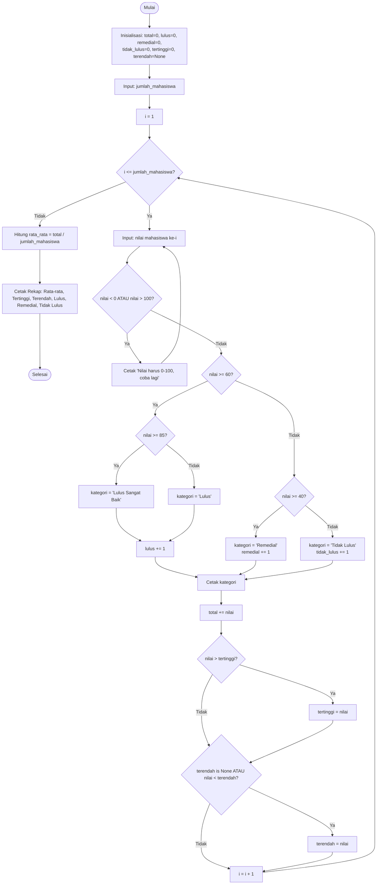

# Laporan Praktikum Week 2 — Percabangan Bertingkat dan Perulangan Dasar

## Identitas Diri
```py
Nama  = "Dendra De Tama"
NIM   = 108052600034
Kelas = "SS1SI-50-REG-01"
Dosen = "Adzanil Rachmadhi Putra"
```

---

## Deskripsi Program

Praktikum Week 2 berfokus pada penguasaan struktur kontrol tingkat lanjut di Python 3 sesuai Modul Praktikum 2 (*Percabangan Bertingkat dan Perulangan Dasar*). Topik utama mencakup **percabangan bertingkat (*nested if*)**, **perulangan terhitung (*for loop* dan fungsi `range()`*)**, **perulangan bersyarat (*while loop*)**, serta **perintah pengontrol loncatan aliran perulangan (`break` dan `continue`)**.

Kumpulan program yang dikembangkan pada praktikum ini terdiri dari:
1. **Latihan Terbimbing**:
   - `latihan1.py`: Penerapan percabangan bertingkat (*nested if*) untuk validasi kelayakan usia menonton film 17+ dan pengecekan kepemilikan kartu pelajar guna penentuan harga tiket.
   - `latihan2.py`: Penggunaan perulangan `for` bersama fungsi `range()` untuk enumerasi bilangan dari 1 hingga 5 serta pembuatan tabel perkalian 3.
   - `latihan3.py`: Penerapan perulangan `while` akumulatif berbasis nilai penanda (*sentinel value*) di mana perulangan terus berjalan menjumlahkan angka hingga pengguna memasukkan angka `0`.
   - `latihan4.py`: Pengendalian alur iterasi menggunakan kata kunci `break` (menghentikan perulangan saat mencapai angka 8) dan `continue` (melewati bilangan genap) untuk mencetak deret ganjil.
2. **Studi Kasus (`studi_kasus.py`)**:
   - Program Rekap Nilai Kuis Kelas yang memadukan `for loop` (iterasi sebanyak jumlah mahasiswa), `while loop` (*input guard* untuk memvalidasi rentang nilai valid 0–100), percabangan bertingkat (*nested if* untuk menentukan kategori kelulusan: *Lulus Sangat Baik*, *Lulus*, *Remedial*, *Tidak Lulus*), kalkulasi rata-rata kelas, akumulator jumlah per kategori, serta pencarian nilai ekstrem (tertinggi dan terendah).

---

## Dekomposisi Masalah

| Sub-Masalah | Plan Pemrograman | Letak di Program | Keterangan |
| :--- | :--- | :--- | :--- |
| **Penyaringan Syarat Berlapis** | *Nested If Statement* | `latihan1.py`, baris 4–10 | Mengevaluasi usia $\ge 17$ tahun terlebih dahulu; jika lolos, mengevaluasi status kartu pelajar. |
| **Enumerasi & Deret Terhitung** | *Count-Controlled Loop (`for`)* | `latihan2.py`, baris 2–3 | Memanfaatkan `range(1, 6)` untuk mencetak deret angka 1 sampai 5. |
| **Kalkulasi Tabel Perkalian** | *Loop with Linear Multiplier* | `latihan2.py`, baris 7–8 | Mengalikan konstanta 3 dengan variabel iterasi `i` pada rentang `range(1, 6)`. |
| **Akumulasi Berhenti Berpenanda** | *Sentinel-Controlled While Loop* | `latihan3.py`, baris 4–6 | Mengulang penambahan nilai ke `total` hingga masukan `angka == 0`. |
| **Interupsi Aliran Iterasi** | *Control Jump (`break` & `continue`)* | `latihan4.py`, baris 3–6 | `continue` mengabaikan bilangan genap (`i % 2 == 0`) dan `break` menghentikan loop seketika saat `i == 8`. |
| **Validasi Rentang Masukan Nilai** | *Input Guard Pattern (`while`)* | `studi_kasus.py`, baris 13–15 | Meminta masukan ulang secara iteratif jika nilai $< 0$ atau $> 100$. |
| **Klasifikasi Kategori Bertingkat** | *Hierarchical Nested If* | `studi_kasus.py`, baris 17–29 | Membagi evaluasi awal pada ambang batas 60, lalu memperinci ke 85 (Sangat Baik) atau 40 (Remedial). |
| **Pelacakan Nilai Ekstrem (Max/Min)**| *Extremum Accumulator Pattern* | `studi_kasus.py`, baris 34–37 | Memperbarui nilai `tertinggi` dan `terendah` (dengan sentinel awal `None`) di setiap iterasi. |
| **Rekapitulasi Statistik Kelas** | Operasi Agregasi & Format Output | `studi_kasus.py`, baris 39–48 | Menghitung rata-rata kelas berpresisi satu desimal (`.1f`) dan mencetak ringkasan hasil rekap. |

---

## Flowchart & Pseudocode

### Flowchart Studi Kasus (`studi_kasus.py`)



---

### Pseudocode Studi Kasus (`studi_kasus.py`)

```text
ALGORITMA RekapKuisKelas
MASUKAN : jumlah_mahasiswa, nilai (setiap mahasiswa) : INTEGER
KELUARAN: kategori per mahasiswa, rata_rata, tertinggi, terendah, lulus, remedial, tidak_lulus

DEKLARASI:
    total, lulus, remedial, tidak_lulus, tertinggi, jumlah_mahasiswa, i, nilai : INTEGER
    terendah : INTEGER ATAU NULL
    rata_rata : FLOAT
    kategori : STRING

PROSES:
    total <- 0
    lulus <- 0
    remedial <- 0
    tidak_lulus <- 0
    tertinggi <- 0
    terendah <- NULL

    BACA jumlah_mahasiswa

    UNTUK i DARI 1 SAMPAI jumlah_mahasiswa LAKUKAN
        BACA nilai
        SELAMA nilai < 0 ATAU nilai > 100 LAKUKAN
            TAMPILKAN "Nilai harus 0-100, coba lagi"
            BACA nilai
        AKHIR SELAMA

        JIKA nilai >= 60 MAKA
            JIKA nilai >= 85 MAKA
                kategori <- "Lulus Sangat Baik"
            SELAIN ITU
                kategori <- "Lulus"
            AKHIR JIKA
            lulus <- lulus + 1
        SELAIN ITU
            JIKA nilai >= 40 MAKA
                kategori <- "Remedial"
                remedial <- remedial + 1
            SELAIN ITU
                kategori <- "Tidak Lulus"
                tidak_lulus <- tidak_lulus + 1
            AKHIR JIKA
        AKHIR JIKA

        TAMPILKAN "Kategori: " + kategori
        total <- total + nilai

        JIKA nilai > tertinggi MAKA
            tertinggi <- nilai
        AKHIR JIKA

        JIKA terendah = NULL ATAU nilai < terendah MAKA
            terendah <- nilai
        AKHIR JIKA
    AKHIR UNTUK

    JIKA jumlah_mahasiswa > 0 MAKA
        rata_rata <- total / jumlah_mahasiswa
    SELAIN ITU
        rata_rata <- 0
    AKHIR JIKA

    TAMPILKAN "=== REKAP KUIS ==="
    TAMPILKAN "Rata-rata   : ", rata_rata
    TAMPILKAN "Tertinggi   : ", tertinggi
    TAMPILKAN "Terendah    : ", terendah
    TAMPILKAN "Lulus       : ", lulus
    TAMPILKAN "Remedial    : ", remedial
    TAMPILKAN "Tidak lulus : ", tidak_lulus
SELESAI
```

---

### Pseudocode `latihan1.py` (Percabangan Bertingkat Tiket)

```text
ALGORITMA PenentuanTiketBioskop
MASUKAN : umur : INTEGER, kartu_pelajar : STRING
KELUARAN: status kelayakan usia dan nominal harga tiket

PROSES:
    BACA umur
    BACA kartu_pelajar

    JIKA umur >= 17 MAKA
        TAMPILKAN "Umur memenuhi syarat nonton film 17+"
        JIKA kartu_pelajar = "ya" MAKA
            TAMPILKAN "Tiket: harga pelajar Rp30000"
        SELAIN ITU
            TAMPILKAN "Tiket: harga umum Rp45000"
        AKHIR JIKA
    SELAIN ITU
        TAMPILKAN "Maaf, film ini khusus usia 17 tahun ke atas"
    AKHIR JIKA
SELESAI
```

---

## Tabel Penelusuran (Trace Table)

Penelusuran manual terhadap skenario masukan pada `studi_kasus.py` sesuai data contoh Modul Halaman 7:
- Jumlah mahasiswa: `5`
- Rangkaian masukan nilai: `80`, `55`, `120 (salah)` $\to$ diulang `90`, `60`, `30`

| Iterasi ($i$) | Nilai Masuk | Guard Validasi ($0 \le nilai \le 100$) | Evaluasi Kategori | Total Kumulatif | Nilai Tertinggi | Nilai Terendah | Penghitung Rekap | Status |
| :---: | :---: | :---: | :--- | :---: | :---: | :---: | :--- | :---: |
| Inisialisasi | - | - | - | `0` | `0` | `None` | L:0, R:0, TL:0 | Sesuai |
| $i = 1$ | `80` | Valid ($80 \in [0, 100]$) | $\ge 60$ dan $< 85 \to$ **Lulus** | $0 + 80 = 80$ | `80` | `80` | L:1, R:0, TL:0 | Sesuai |
| $i = 2$ | `55` | Valid ($55 \in [0, 100]$) | $< 60$ dan $\ge 40 \to$ **Remedial** | $80 + 55 = 135$ | `80` | `55` | L:1, R:1, TL:0 | Sesuai |
| $i = 3$ | `120` | **Tidak Valid** ($> 100$) | Masuk loop `while`, minta ulang masukan | $135$ | `80` | `55` | - | Sesuai |
| $i = 3$ (ulang)| `90` | Valid ($90 \in [0, 100]$) | $\ge 60$ dan $\ge 85 \to$ **Lulus Sangat Baik** | $135 + 90 = 225$ | `90` | `55` | L:2, R:1, TL:0 | Sesuai |
| $i = 4$ | `60` | Valid ($60 \in [0, 100]$) | $\ge 60$ dan $< 85 \to$ **Lulus** | $225 + 60 = 285$ | `90` | `55` | L:3, R:1, TL:0 | Sesuai |
| $i = 5$ | `30` | Valid ($30 \in [0, 100]$) | $< 60$ dan $< 40 \to$ **Tidak Lulus** | $285 + 30 = 315$ | `90` | `30` | L:3, R:1, TL:1 | Sesuai |
| **Hasil Akhir**| - | Rata-rata $= 315 / 5 = \mathbf{63.0}$ | **Tertinggi:** $90$, **Terendah:** $30$ | Total: $315$ | Max: `90` | Min: `30` | **L:3, R:1, TL:1** | **Sesuai** |

---

## Tabel Kasus Uji

| No | Program | Kategori Uji | Masukan (*Input*) | Hasil yang Diharapkan (*Expected*) | Hasil Program (*Actual*) | Status |
| :---: | :--- | :--- | :--- | :--- | :--- | :---: |
| 1 | `latihan1.py` | **Normal** | umur = 20, kartu = "ya" | "Umur memenuhi syarat nonton film 17+"<br>"Tiket: harga pelajar Rp30000" | Sesuai output modul | PASS |
| 2 | `latihan1.py` | **Normal** | umur = 20, kartu = "tidak" | "Umur memenuhi syarat nonton film 17+"<br>"Tiket: harga umum Rp45000" | Sesuai output modul | PASS |
| 3 | `latihan1.py` | **Batas Bawah** | umur = 15, kartu = "ya" | "Maaf, film ini khusus usia 17 tahun ke atas" | Sesuai output modul | PASS |
| 4 | `latihan2.py` | **Normal** | *(Tanpa input)* | Menghitung 1 s.d. 5 dan tabel perkalian 3 (3 x 1 = 3 s.d. 3 x 5 = 15) | Sesuai output modul | PASS |
| 5 | `latihan3.py` | **Normal** | 10, 20, 5, 0 | Total semua angka: 35 | Sesuai output modul | PASS |
| 6 | `latihan4.py` | **Aliran Kontrol** | *(Tanpa input)* | Mencetak hanya ganjil (1, 3, 5, 7) dan berhenti sebelum angka 8 | Sesuai output modul | PASS |
| 7 | `studi_kasus.py` | **Batas (Sangat Baik)**| nilai = 85 | Kategori: Lulus Sangat Baik | Sesuai harapan | PASS |
| 8 | `studi_kasus.py` | **Batas (Lulus)** | nilai = 60 | Kategori: Lulus | Sesuai harapan | PASS |
| 9 | `studi_kasus.py` | **Batas (Remedial)** | nilai = 40 | Kategori: Remedial | Sesuai harapan | PASS |
| 10 | `studi_kasus.py` | **Batas (Tidak Lulus)**| nilai = 39 | Kategori: Tidak Lulus | Sesuai harapan | PASS |
| 11 | `studi_kasus.py` | **Input Guard** | nilai = 120 $\to$ ulang 90 | "Nilai harus 0-100, coba lagi" lalu diterima nilai 90 | Sesuai output modul | PASS |
| 12 | `studi_kasus.py` | **Rekap Lengkap** | 5 mhs (80, 55, 120$\to$90, 60, 30) | Rata-rata: 63.0, Max: 90, Min: 30, Lulus: 3, Remedial: 1, Tidak Lulus: 1 | Sesuai output modul | PASS |

---

## Catatan Pertanyaan Modul & Analisis Galat

### Jawaban Pertanyaan Praktik Modul:
1. **Latihan 1 (Langkah 4)**: Mengapa pertanyaan kartu pelajar tetap diajukan pada umur 15 tetapi tidak berpengaruh pada hasil?
   - *Jawaban*: Karena perintah `kartu_pelajar = input(...)` dieksekusi secara sekuensial sebelum struktur `if umur >= 17:`. Ketika kondisi `umur >= 17` bernilai `False`, alur program langsung melompat ke blok `else` luar tanpa pernah mengevaluasi percabangan kartu pelajar di dalamnya.
2. **Latihan 4 (Langkah 4)**: Angka berapa saja yang dilewati oleh `continue`, dan pada angka berapa `break` menghentikan perulangan?
   - *Jawaban*: Kata kunci `continue` melewati seluruh bilangan genap (yaitu angka `2`, `4`, dan `6`). Kata kunci `break` menghentikan loop seketika pada saat variabel iterasi `i` bernilai `8`, sehingga angka `8`, `9`, dan `10` tidak pernah diproses sama sekali.

### Analisis Potensi Galat:
1. **Galat Perulangan Tak Berujung (*Infinite Loop*)**:
   - *Penyebab*: Menghilangkan pembacaan ulang input `angka = int(input(...))` di dalam blok `while` pada `latihan3.py` (Langkah 4).
   - *Cara Menemukan*: Nilai `angka` tidak pernah berubah menjadi `0`, sehingga kondisi `angka != 0` selalu bernilai `True` dan program menjumlahkan angka yang sama berulang-ulang tanpa henti hingga dipaksa berhenti dengan `Ctrl + C`.
   - *Perbaikan*: Memastikan variabel pengendali kondisi perulangan selalu di-*update* di dalam badan loop `while`.

2. **Galat Logika Pelacakan Nilai Minimum (*Minimum Tracking Logic Error*)**:
   - *Penyebab*: Menginisialisasi variabel `terendah = 0`. Jika seluruh mahasiswa mendapatkan nilai positif (misal: 60, 80, 90), nilai terendah akan tetap `0` karena tidak ada nilai yang $< 0$.
   - *Cara Menemukan*: Rekapitulasi akhir menampilkan `Terendah : 0` padahal tidak ada mahasiswa yang mendapat nilai 0.
   - *Perbaikan*: Menginisialisasi dengan `terendah = None` dan menggunakan evaluasi kondisi majemuk `if terendah is None or nilai < terendah:` agar nilai mahasiswa pertama langsung menjadi acuan awal minimum.

---

## Refleksi

Praktikum Week 2 memberikan pemahaman komprehensif mengenai penggabungan percabangan bertingkat (*nested if*) dan perulangan (*looping*). Konsep percabangan bertingkat terbukti sangat berguna saat suatu keputusan bergantung penuh pada pemenuhan syarat di tahap awal.

Dalam hal struktur perulangan, pemilihan antara `for` dan `while` menjadi lebih jelas:
- `for` digunakan secara terukur ketika jumlah iterasi telah diketahui di awal (seperti jumlah mahasiswa atau deret angka tetap dengan `range()`).
- `while` digunakan ketika kondisi akhir belum pasti, seperti penerapan *input guard* yang menolak input nilai di luar rentang 0–100 sampai pengguna memasukkan data yang valid.

Pemahaman mekanisme `break` dan `continue` melengkapi kendali alur eksekusi loop, di mana `continue` berfungsi sebagai filter penyaring data yang tidak relevan, sedangkan `break` bertindak sebagai pemutus darurat saat kondisi terminasi terpenuhi.

---

## Pengungkapan Penggunaan AI

- **Bagian yang Dibantu AI**:
  - Perancangan bagan alir (*flowchart*) Mermaid yang menggambarkan integrasi perulangan `for`, *input guard* `while`, dan *nested if*.
  - Penyusunan pseudocode dan tabel penelusuran (*trace table*) yang selaras dengan contoh studi kasus pada Modul Praktikum 2.
  - Perumusan variasi kasus uji batas (*boundary tests*) dan input tidak valid.
- **Saran AI yang Dipakai**:
  - Penerapan inisialisasi `terendah = None` untuk menyelesaikan tantangan opsional pencarian nilai minimum secara akurat tanpa terganggu bias nilai awal 0.
  - Penanganan kasus pembagian nol pada rata-rata menggunakan ekspresi kondisional satu baris `total / jumlah_mahasiswa if jumlah_mahasiswa > 0 else 0`.
- **Saran AI yang Ditolak & Alasannya**:
  - Saran menggunakan fungsi bawaan `min()` dan `max()` dari Python, ditolak agar tetap melatih logika manual algoritma pembandingan bersyarat (`if`) sesuai tujuan pembelajaran modul.
  - Saran menggunakan penanganan eksepsi `try-except`, ditolak karena materi modul difokuskan pada validasi logika kontrol `while` dan `nested if`.
