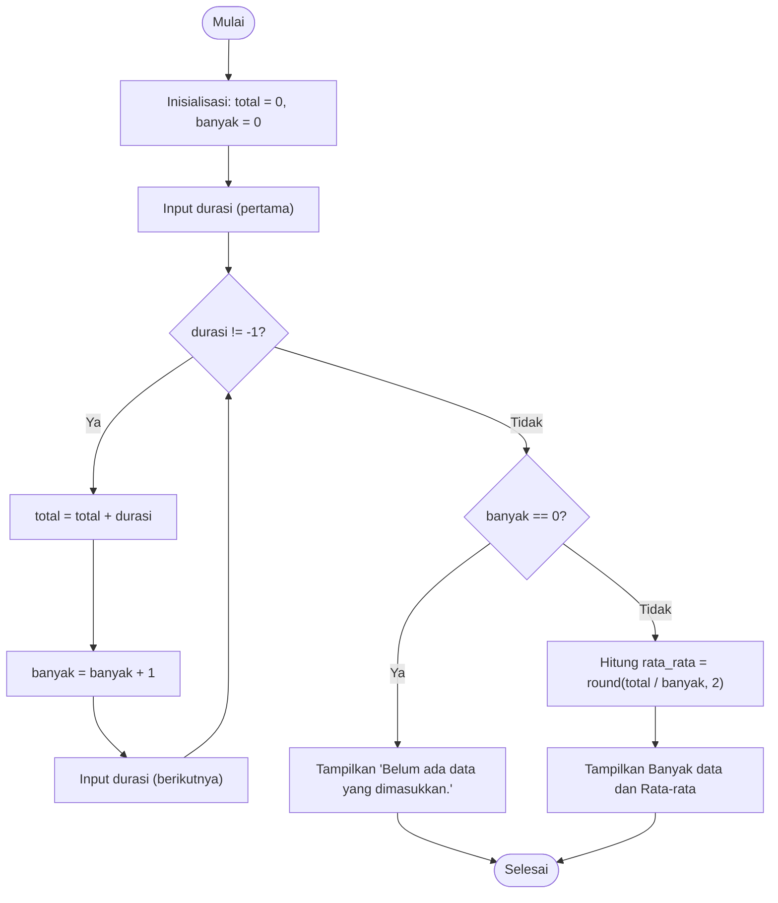

# Laporan Praktikum Week 3 — Pola Perulangan: Penelusuran, Penanda, dan Pengolahan Data

## Identitas Diri
```py
Nama  = "Dendra De Tama"
NIM   = 108052600034
Kelas = "SS1SI-50-REG-01"
Dosen = "Adzanil Rachmadhi Putra"
```

---

## Deskripsi Program

Praktikum Week 3 membahas teknik perancangan, verifikasi, dan analisis algoritma perulangan (*looping*) secara mendalam. Pembahasan tidak lagi berfokus pada sintaks dasar, melainkan pada keandalan logika struktur perulangan melalui **tabel penelusuran (*trace table*)**, **analisis jaminan berhenti (*termination guarantee*)**, **pencegahan kesalahan satu putaran (*off-by-one error*)**, serta **pola masukan berpenanda (*sentinel loop*)**. Selain itu, praktikum ini membedah empat pola dasar pengolahan data dalam perulangan, yaitu: **akumulator**, **pencacah (*counter*)**, **penyaringan (*filtering*)**, dan **penelusuran nilai ekstrem**.

Program-program yang dipelajari dan diimplementasikan pada pertemuan ini meliputi:
1. **`latihan1.py` (dan `task1.py`)**: Program kalkulasi kelipatan dua dari rentang 1 hingga 5 menggunakan perulangan `while` yang dianalisis secara manual menggunakan tabel penelusuran untuk memverifikasi perubahan state variabel `n` dan `total`.
2. **`latihan2.py` (dan `task2.py`)**: Program penjumlahan deret bilangan 1 sampai $n$. Program ini merefleksikan proses identifikasi galat *off-by-one* (perbedaan operator `<` vs `<=`) dan pengujian kondisi batas ($n = 5$, $n = 1$, dan data nol $n = 0$).
3. **`latihan3.py` (dan `task3.py`)**: Program penghitung rata-rata waktu proses mesin berbasis *sentinel value* `-1` dengan menerapkan pola baca ganda (*read-twice pattern*) serta mekanisme proteksi data kosong (*zero-division guard*).
4. **`latihan4.py` (dan `task4.py`)**: Program rekapitulasi data produksi harian lini pabrik selama 10 hari yang mengintegrasikan pola akumulator (`total`) dan pola pencacah bersyarat (`di_bawah`) terhadap target harian.

---

## Dekomposisi Masalah

| Sub-Masalah | Plan Pemrograman | Letak di Program | Keterangan |
| :--- | :--- | :--- | :--- |
| **Penelusuran State Perulangan** | *Trace Table Verification* | `latihan1.py`, baris 4–6 | Menelusuri transisi variabel pengontrol `n` dan akumulator `total` tiap iterasi. |
| **Pembaruan Nilai Melangkah (*Step*)** | Operasi Penambahan Monotonik | `latihan1.py`, baris 6 | Pernyataan `n = n + 1` menjamin kondisi `n <= 5` suatu saat bernilai `False`. |
| **Koreksi Batas Atas Deret** | *Inclusive Boundary Guard (`<=`)* | `latihan2.py`, baris 5 | Memastikan nilai batas atas $n$ ikut diproses, mencegah hilangnya iterasi terakhir. |
| **Penanganan Batas Nol (*Boundary Case*)** | Evaluasi Kondisi Awal Instan | `latihan2.py`, baris 5, 9 | Menjamin masukan $n = 0$ langsung mengabaikan blok perulangan tanpa memicu galat. |
| **Pola Pembacaan Ganda (*Read-Twice*)** | *Pre-read & Loop-end Read Pattern* | `latihan3.py`, baris 4, 9 | Membaca sebelum loop dan di akhir blok agar nilai sentinel `-1` tidak ikut terproses. |
| **Penghitungan Frekuensi Kejadian** | *Counter Pattern* | `latihan3.py`, baris 8 | Menambahkan pencacah `banyak = banyak + 1` setiap ada durasi yang sah. |
| **Pencegahan Galat Pembagian Nol** | *Zero-Division Guard Condition* | `latihan3.py`, baris 11–15 | Mengevaluasi `if banyak == 0` sebelum menghitung rata-rata `total / banyak`. |
| **Pembulatan Presisi Rata-Rata** | Fungsi Intrinsik `round()` | `latihan3.py`, baris 15 | Memformat presisi nilai desimal rata-rata hingga dua digit di belakang koma. |
| **Akumulasi Kuantitas Produksi** | *Accumulator Pattern* | `latihan4.py`, baris 9 | Menjumlahkan unit produksi harian ke dalam variabel `total`. |
| **Penyaringan Terhadap Ambang Batas** | *Conditional Counter Filtering* | `latihan4.py`, baris 10–11 | Menyaring hari yang produksinya di bawah batas target (`produksi < TARGET`). |
| **Kalkulasi Rata-Rata Terdistribusi** | Operasi Pembagian Skalar Konstan | `latihan4.py`, baris 14 | Menghitung rata-rata harian dengan membagi akumulator terhadap konstanta `HARI`. |

---

## Flowchart & Pseudocode

### Flowchart Masukan Berpenanda & Proteksi Data Kosong (`latihan3.py`)



---

### Pseudocode `latihan2.py` (Koreksi Kondisi Batas Penjumlahan 1 s.d. n)

```text
ALGORITMA PenjumlahanDeret
MASUKAN : n : INTEGER
KELUARAN: total : INTEGER

DEKLARASI:
    n, total, i : INTEGER

PROSES:
    BACA n
    total <- 0
    i <- 1

    SELAMA i <= n LAKUKAN
        total <- total + i
        i <- i + 1
    AKHIR SELAMA

    TAMPILKAN "Jumlah:", total
SELESAI
```

---

### Pseudocode `latihan4.py` (Akumulator & Pencacah Produksi Harian)

```text
ALGORITMA RekapProduksiTarget
MASUKAN : produksi (setiap hari ke-1 s.d. 10) : INTEGER
KELUARAN: total, rata_rata, di_bawah

DEKLARASI:
    KONSTANTA TARGET = 50
    KONSTANTA HARI = 10
    total, di_bawah, hari, produksi : INTEGER
    rata_rata : FLOAT

PROSES:
    total <- 0
    di_bawah <- 0

    UNTUK hari DARI 1 SAMPAI HARI LAKUKAN
        BACA produksi
        total <- total + produksi
        JIKA produksi < TARGET MAKA
            di_bawah <- di_bawah + 1
        AKHIR JIKA
    AKHIR UNTUK

    rata_rata <- total / HARI

    TAMPILKAN "Total produksi:", total
    TAMPILKAN "Rata-rata per hari:", rata_rata
    TAMPILKAN "Hari di bawah target:", di_bawah
SELESAI
```

---

## Tabel Penelusuran (Trace Table)

### 1. Tabel Penelusuran `latihan1.py`
Kode program: `total = 0; n = 1; while n <= 5: total = total + n * 2; n = n + 1`

| Pemeriksaan ke- | Nilai `n` | Kondisi `n <= 5` | Ekspresi `n * 2` | `total` (sebelumnya + tambah) | `n` sesudah pembaruan |
| :---: | :---: | :---: | :---: | :---: | :---: |
| 1 | 1 | **True** | 2 | $0 + 2 = 2$ | 2 |
| 2 | 2 | **True** | 4 | $2 + 4 = 6$ | 3 |
| 3 | 3 | **True** | 6 | $6 + 6 = 12$ | 4 |
| 4 | 4 | **True** | 8 | $12 + 8 = 20$ | 5 |
| 5 | 5 | **True** | 10 | $20 + 10 = 30$ | 6 |
| 6 | 6 | **False** | - | Perulangan Berhenti | 6 |

*Hasil Akhir Tercetak*: `total = 30` (Kondisi diperiksa sebanyak **6 kali**, dengan **5 kali iterasi sukses**).

---

### 2. Tabel Komparasi Kondisi Batas `latihan2.py` ($n = 5$)

Perbandingan antara kode sebelum perbaikan (`i < n`) dan sesudah perbaikan (`i <= n`):

| Pemeriksaan ke- | Nilai `i` | Kondisi Bug `i < 5` | `total` (Bug) | Kondisi Perbaikan `i <= 5` | `total` (Valid) | Keterangan |
| :---: | :---: | :---: | :---: | :---: | :---: | :--- |
| 1 | 1 | True | 1 | True | 1 | $0 + 1$ |
| 2 | 2 | True | 3 | True | 3 | $1 + 2$ |
| 3 | 3 | True | 6 | True | 6 | $3 + 3$ |
| 4 | 4 | True | 10 | True | 10 | $6 + 4$ |
| 5 | 5 | **False (Macet)** | **10 (Salah)** | **True** | **15 (Benar)** | Pada kode bug, $i = 5$ terlewat |
| 6 | 6 | - | - | **False (Selesai)**| 15 | Berhenti pada batas yang tepat |

---

### 3. Tabel Penelusuran Sentinel `latihan3.py`
Masukan urut: `12`, `15`, `10`, `-1`

| Langkah | Masukan `durasi` | Evaluasi `durasi != -1` | `total` Kumulatif | `banyak` Data | Status Pembacaan |
| :---: | :---: | :---: | :---: | :---: | :--- |
| Pembacaan 1 | 12 | True | $0 + 12 = 12$ | 1 | Data valid ke-1 |
| Pembacaan 2 | 15 | True | $12 + 15 = 27$ | 2 | Data valid ke-2 |
| Pembacaan 3 | 10 | True | $27 + 10 = 37$ | 3 | Data valid ke-3 |
| Pembacaan 4 | -1 | **False** | 37 (tetap) | 3 (tetap) | Sentinel terdeteksi $\to$ loop henti |
| **Output Akhir** | - | Evaluasi `banyak == 0` $\to$ **False** | Rata-rata $= 37 / 3 = \mathbf{12.33}$ | **Banyak: 3** | **Sesuai Ekspektasi** |

---

## Tabel Kasus Uji

| No | Program | Kategori Uji | Masukan (*Input*) | Hasil yang Diharapkan (*Expected*) | Hasil Aktual Program (*Actual*) | Status |
| :---: | :--- | :--- | :--- | :--- | :--- | :---: |
| 1 | `latihan1.py` | **Normal** | Loop otomatis ($n=1..5$) | `total = 30` | `total = 30` | PASS |
| 2 | `latihan2.py` | **Normal** | $n = 5$ | `Jumlah: 15` | `Jumlah: 15` | PASS |
| 3 | `latihan2.py` | **Batas** | $n = 1$ | `Jumlah: 1` | `Jumlah: 1` | PASS |
| 4 | `latihan2.py` | **Batas Ekstrem** | $n = 0$ | `Jumlah: 0` (langsung lewati loop) | `Jumlah: 0` | PASS |
| 5 | `latihan3.py` | **Normal** | 12, 15, 10, -1 | Banyak data: 3, Rata-rata: 12.33 menit | Sesuai ekspektasi | PASS |
| 6 | `latihan3.py` | **Kasus Kosong** | Langsung memasukkan `-1` | "Belum ada data yang dimasukkan." | Sesuai ekspektasi | PASS |
| 7 | `latihan4.py` | **Normal** | 48, 52, 39, 61, 55, 44, 58, 36, 63, 50 | Total: 506, Rata-rata: 50.6, Di bawah target: 4 | Sesuai ekspektasi | PASS |
| 8 | `task1.py` | **Regresi** | Loop otomatis ($n=1..5$) | `total = 30` | `total = 30` | PASS |
| 9 | `task2.py` | **Batas** | $n = 5$ | `Jumlah: 15` | `Jumlah: 15` | PASS |
| 10 | `task3.py` | **Kasus Kosong** | Langsung memasukkan `-1` | "Belum ada data yang dimasukkan." | Sesuai ekspektasi | PASS |
| 11 | `task4.py` | **Batas Nilai**| 10 hari produksi tepat 50 | Total: 500, Di bawah target: 0 | Sesuai ekspektasi | PASS |

---

## Catatan Galat

1. **Galat Kondisi Batas (*Off-by-One Logic Error*)**:
   - *Penyebab*: Penggunaan operator komparasi relasional strictly less than (`i < n`) pada struktur `while` di `latihan2.py`. Hal ini mengakibatkan iterasi putaran ke-$n$ terlewatkan sebelum sempat diakumulasikan.
   - *Cara Menemukan*: Pengujian manual terhadap nilai masukan batas $n = 5$ menghasilkan total `10` alih-alih `15`. Melalui penelusuran tabel, ditemukan bahwa loop berhenti saat $i = 5$.
   - *Perbaikan*: Mengganti operator relasional menjadi perbandingan inklusif `while i <= n:`.

2. **Galat Penempatan Masukan Penanda (*Read-Twice Inversion Bug*)**:
   - *Penyebab*: Menempatkan perintah pembacaan masukan kedua di awal baris blok perulangan alih-alih di akhir blok pada `latihan3.py`.
   - *Cara Menemukan*: Saat program diuji, data pertama yang dimasukkan sebelum loop langsung tertimpa oleh data kedua tanpa sempat diakumulasikan. Selain itu, nilai sentinel `-1` ikut dijumlahkan ke dalam variabel `total` dan menaikkan nilai variabel `banyak`.
   - *Perbaikan*: Menerapkan pola pembacaan ganda secara disiplin: pembacaan pertama diletakkan tepat sebelum `while`, dan pembacaan pembaruan diletakkan tepat di baris paling akhir di dalam blok `while`.

3. **Galat Pembagian dengan Nol (*ZeroDivisionError Runtime Error*)**:
   - *Penyebab*: Melakukan kalkulasi rata-rata `total / banyak` saat pengguna langsung memasukkan nilai penanda `-1` pada input pertama.
   - *Cara Menemukan*: Program mengalami *crash* mendadak dengan pesan `ZeroDivisionError: division by zero` ketika diuji dengan skenario tanpa transaksi data.
   - *Perbaikan*: Memasang blok percabangan penjaga (*guard condition*) `if banyak == 0:` guna menampilkan pesan peringatan dan mencegah eksekusi pembagian aritmatika.

---

## Refleksi

Praktikum Week 3 memberikan pemahaman yang sangat penting bahwa kode yang sintaksnya benar (*bebas dari SyntaxError*) belum tentu menghasilkan logika yang dapat dipercaya. Pembuatan tabel penelusuran (*trace table*) membuktikan fungsinya sebagai alat verifikasi logika paling efektif sebelum program dieksekusi di komputer. Dengan menuliskan kondisi dan pembaruan variabel langkah demi langkah di kertas, kesalahan tersembunyi seperti *off-by-one error* dan penanganan nilai batas ($n=0$) dapat diidentifikasi secara presisi.

Pola masukan berpenanda (*sentinel*) juga memberikan paradigma baru dalam menangani data yang dinamis tanpa harus mengetahui kuantitasnya di awal. Penerapan pola baca dua kali (*read-twice*) mengajarkan disiplin penataan urutan instruksi di dalam badan perulangan agar nilai sentinel murni berfungsi sebagai terminator, bukan sebagai bagian dari data komputasi.

Batasan pada implementasi saat ini adalah masukan pengguna masih mengandalkan fungsi `int(input())` tanpa blok penangkap galat `try-except`. Apabila pengguna memasukkan teks non-numerik (misalnya string huruf saat diminta durasi), program akan mengalami *crash* dengan eksepsi `ValueError`.

---

## Pengungkapan Penggunaan AI

- **Bagian yang Dibantu AI**:
  - Penyusunan format visual tabel penelusuran komparatif (*trace table*) antara kondisi bug `i < n` versus perbaikan `i <= n`.
  - Pembuatan diagram alir Mermaid terstruktur untuk merepresentasikan siklus baca ganda masukan berpenanda (*sentinel loop*) beserta proteksi data kosong.
  - Formulasi skenario kasus uji batas (*edge cases*), terutama pada pengujian masukan nilai batas $n = 0$ dan masukan penanda instan.
- **Saran AI yang Dipakai**:
  - Penambahan visualisasi alur percabangan data kosong (`banyak == 0`) pada flowchart `latihan3.py` untuk menegaskan prinsip *defensive programming*.
  - Perancangan tabel dekomposisi masalah dengan kategorisasi pola pemrograman (Akumulator, Pencacah, *Boundary Guard*, *Read-Twice Pattern*).
- **Saran AI yang Ditolak & Alasannya**:
  - Penambahan modul fungsi built-in `sum()` dan generator `range()` untuk menyederhanakan `latihan2.py`, ditolak karena tujuan instruksional modul adalah menguasai alur eksplisit perulangan `while` dan analisis state variabel secara manual.
  - Penyisipan penanganan eksepsi `try-except ValueError`, ditolak untuk menjaga kepatuhan terhadap batasan materi resmi Modul 3.

