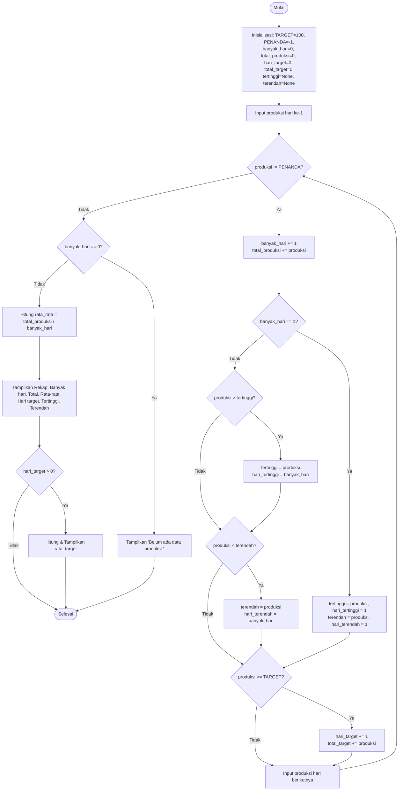

# Laporan Praktikum Week 4 — Pola Perulangan: Penelusuran, Penanda, dan Pengolahan Data (Bagian 2)

## Identitas Diri
```py
Nama  = "Dendra De Tama"
NIM   = 108052600034
Kelas = "SS1SI-50-REG-01"
Dosen = "Adzanil Rachmadhi Putra"
```

---

## Deskripsi Program

Praktikum Week 4 merupakan kelanjutan dari Modul Praktikum 3 & 4 (*Pola Perulangan: Penelusuran, Penanda, dan Pengolahan Data*). Fokus praktikum ini mendalami penerapan pola lanjutan di dalam struktur perulangan, yang mencakup: **pola penyaringan (*filtering*)**, **analisis dan penanganan nilai ekstrem beserta jebakan inisialisasi (*extremum tracking & initial value pitfall*)**, **dekomposisi dan pengelompokan masalah (*problem grouping*)**, serta **pengolahan data terpadu berbasis masukan berpenanda (*sentinel*)**.

Kumpulan program yang diimplementasikan pada praktikum Week 4 terdiri dari:
1. **Latihan Terbimbing**:
   - `latihan1.py` *(Modul Latihan 5)*: Penerapan pola penyaringan (*filtering*) menggunakan kondisi `if produksi >= TARGET` untuk menyaring dan menghitung hanya unit produksi yang memenuhi target harian ($\ge 50$), lengkap dengan proteksi pembagian nol jika tidak ada hari yang lolos.
   - `latihan2.py` *(Modul Latihan 6)*: Analisis jebakan inisialisasi nilai ekstrem (`tertinggi = 0` vs `None`) pada data laba bulanan yang bernilai negatif, diperluas dengan pelacakan indeks nomor bulan terjadinya laba tertinggi (`bulan_tertinggi`).
   - `latihan3.py` *(Modul Latihan 7)*: Penerapan teknik pengelompokan masalah (*problem grouping*) untuk menguraikan tiga sub-masalah pencatatan suhu mesin (suhu tertinggi dan nomor pencatatan, frekuensi suhu $> 80^\circ$, serta rata-rata suhu yang lolos saring).
2. **Studi Kasus (`studi_kasus.py`)**:
   - Program Rekap Produksi Harian Lini Perakitan yang mengintegrasikan masukan berpenanda sentinel `-1`, pola akumulator total produksi, pola pencacah hari target ($\ge 100$), pelacakan produksi tertinggi dan terendah dengan pemutus seri hari paling awal (*earliest tie-breaker*), proteksi transaksi data kosong, serta tantangan tambahan berupa kalkulasi rata-rata khusus hari yang mencapai target.

---

## Dekomposisi Masalah

| Sub-Masalah | Plan Pemrograman | Letak di Program | Keterangan |
| :--- | :--- | :--- | :--- |
| **Penyaringan Ambang Batas** | *Conditional Filter Pattern* | `latihan1.py`, baris 9–11 | Menggunakan `if produksi >= TARGET` untuk memisahkan data yang memenuhi syarat. |
| **Proteksi Himpunan Data Kosong** | *Zero-Division Guard* | `latihan1.py`, baris 13–15 | Menampilkan pesan khusus jika `banyak_lolos == 0` untuk menghindari pembagian dengan nol. |
| **Inisialisasi Nilai Ekstrem Aman** | *Sentinel None Pattern* | `latihan2.py`, baris 1, 6 | Menetapkan `tertinggi = None` agar data negatif pertama otomatis menjadi nilai acuan awal. |
| **Pelacakan Indeks Posisi Ekstrem** | *Index / Temporal Tracking* | `latihan2.py`, baris 8 | Menyimpan variabel `bulan_tertinggi = bulan` bersamaan dengan pembaruan nilai laba maksimum. |
| **Penguraian Masalah Multi-Objektif** | *Problem Grouping via Comments* | `latihan3.py`, baris 1–4 | Mendokumentasikan sub-masalah dan pola sebelum menuliskan instruksi program. |
| **Penyaringan Ketat (*Strict Inequality*)** | *Relational Comparison (`>`)* | `latihan3.py`, baris 13 | Menghitung data yang strictly lebih besar dari $80^\circ$ (`suhu > 80`). |
| **Skema Masukan Penanda Berhenti** | *Read-Twice Sentinel Pattern* | `studi_kasus.py`, baris 14, 37 | Membaca sebelum perulangan dan di akhir blok loop sampai ditemukan `PENANDA = -1`. |
| **Inisialisasi Nilai Ekstrem Hari ke-1** | *First-Record Initialization* | `studi_kasus.py`, baris 20–24 | Mengisi `tertinggi` dan `terendah` langsung dengan nilai hari ke-1 pada iterasi pertama. |
| **Pemutus Seri Nilai Ekstrem Terawal** | *Strict Comparison Tie-Breaker* | `studi_kasus.py`, baris 26, 29 | Menggunakan operator ketat `>` dan `<` agar hari terawal tetap dipertahankan saat ada nilai kembar. |
| **Agregasi Khusus Hari Target** | *Selective Aggregation* | `studi_kasus.py`, baris 33–35, 51–53 | Mengakumulasi nilai dan mencacah hari yang $\ge 100$ untuk tantangan rata-rata hari target. |

---

## Flowchart & Pseudocode

### Flowchart Studi Kasus (`studi_kasus.py`)



---

### Pseudocode Studi Kasus (`studi_kasus.py`)

```text
ALGORITMA RekapProduksiLiniPerakitan
MASUKAN : produksi (setiap hari sampai bernilai -1) : INTEGER
KELUARAN: banyak_hari, total_produksi, rata_rata, hari_target, tertinggi, terendah, rata_target

DEKLARASI:
    KONSTANTA TARGET = 100
    KONSTANTA PENANDA = -1
    banyak_hari, total_produksi, hari_target, total_target, produksi : INTEGER
    tertinggi, hari_tertinggi, terendah, hari_terendah : INTEGER ATAU NULL
    rata_rata, rata_target : FLOAT

PROSES:
    banyak_hari <- 0
    total_produksi <- 0
    hari_target <- 0
    total_target <- 0
    tertinggi <- NULL
    terendah <- NULL

    BACA produksi

    SELAMA produksi != PENANDA LAKUKAN
        banyak_hari <- banyak_hari + 1
        total_produksi <- total_produksi + produksi

        JIKA banyak_hari = 1 MAKA
            tertinggi <- produksi
            hari_tertinggi <- 1
            terendah <- produksi
            hari_terendah <- 1
        SELAIN ITU
            JIKA produksi > tertinggi MAKA
                tertinggi <- produksi
                hari_tertinggi <- banyak_hari
            AKHIR JIKA
            JIKA produksi < terendah MAKA
                terendah <- produksi
                hari_terendah <- banyak_hari
            AKHIR JIKA
        AKHIR JIKA

        JIKA produksi >= TARGET MAKA
            hari_target <- hari_target + 1
            total_target <- total_target + produksi
        AKHIR JIKA

        BACA produksi
    AKHIR SELAMA

    TAMPILKAN "=== REKAP PRODUKSI ==="
    JIKA banyak_hari = 0 MAKA
        TAMPILKAN "Belum ada data produksi."
    SELAIN ITU
        rata_rata <- total_produksi / banyak_hari
        TAMPILKAN "Banyak hari       :", banyak_hari
        TAMPILKAN "Total produksi    :", total_produksi
        TAMPILKAN "Rata-rata per hari:", rata_rata
        TAMPILKAN "Hari mencapai target (100):", hari_target
        TAMPILKAN "Tertinggi:", tertinggi, "unit (hari ke-", hari_tertinggi, ")"
        TAMPILKAN "Terendah :", terendah, "unit (hari ke-", hari_terendah, ")"

        JIKA hari_target > 0 MAKA
            rata_target <- total_target / hari_target
            TAMPILKAN "Rata-rata hari target:", rata_target
        AKHIR JIKA
    AKHIR JIKA
SELESAI
```

---

### Pseudocode `latihan3.py` (Pengelompokan Masalah Pencatatan Suhu)

```text
ALGORITMA PengelompokanMasalahSuhu
MASUKAN : suhu (pencatatan ke-1 s.d. 8) : INTEGER
KELUARAN: suhu tertinggi beserta urutan, banyak_diatas_80, rata_rata

PROSES:
    tertinggi <- NULL
    urutan_tertinggi <- NULL
    banyak_diatas_80 <- 0
    total_diatas_80 <- 0

    UNTUK i DARI 1 SAMPAI 8 LAKUKAN
        BACA suhu
        JIKA tertinggi = NULL ATAU suhu > tertinggi MAKA
            tertinggi <- suhu
            urutan_tertinggi <- i
        AKHIR JIKA

        JIKA suhu > 80 MAKA
            banyak_diatas_80 <- banyak_diatas_80 + 1
            total_diatas_80 <- total_diatas_80 + suhu
        AKHIR JIKA
    AKHIR UNTUK

    TAMPILKAN "Suhu tertinggi:", tertinggi, "(pencatatan ke-", urutan_tertinggi, ")"
    JIKA banyak_diatas_80 = 0 MAKA
        TAMPILKAN "Tidak ada suhu yang melebihi 80"
    SELAIN ITU
        TAMPILKAN "Suhu melebihi 80:", banyak_diatas_80, "kali"
        TAMPILKAN "Rata-rata suhu yang melebihi 80:", total_diatas_80 / banyak_diatas_80
    AKHIR JIKA
SELESAI
```

---

## Tabel Penelusuran (Trace Table)

Penelusuran manual terhadap skenario masukan `studi_kasus.py` (Data Modul Halaman 13):
- Rangkaian masukan produksi: `120`, `95`, `70`, `100`, `80`, `-1`

| Hari | Input | Evaluasi `!= -1` | `total` | `hari_target` ($\ge 100$) | `tertinggi` (hari) | `terendah` (hari) | Evaluasi Ekstrem |
| :---: | :---: | :---: | :---: | :---: | :---: | :---: | :--- |
| Inisialisasi | - | - | 0 | 0 | None (-) | None (-) | State awal |
| 1 | 120 | True | 120 | 1 | 120 (hari 1) | 120 (hari 1) | Hari pertama langsung inisialisasi min & max |
| 2 | 95 | True | 215 | 1 | 120 (hari 1) | 95 (hari 2) | $95 < 120 \to$ terendah diperbarui |
| 3 | 70 | True | 285 | 1 | 120 (hari 1) | 70 (hari 3) | $70 < 95 \to$ terendah diperbarui |
| 4 | 100 | True | 385 | 2 | 120 (hari 1) | 70 (hari 3) | $100 \ge 100 \to$ hari_target bertambah |
| 5 | 80 | True | 465 | 2 | 120 (hari 1) | 70 (hari 3) | Tidak ada pembaruan ekstrem |
| 6 | -1 | **False** | 465 | 2 | 120 (hari 1) | 70 (hari 3) | Sentinel terdeteksi $\to$ loop henti |
| **Rekap** | - | **Rata-rata: 93.00** | **465** | **2 hari** | **120 unit (hari 1)** | **70 unit (hari 3)** | **Rata-rata target: 110.00** |

---

## Tabel Kasus Uji

| No | Program | Kategori Uji | Masukan (*Input*) | Hasil yang Diharapkan (*Expected*) | Hasil Aktual Program (*Actual*) | Status |
| :---: | :--- | :--- | :--- | :--- | :--- | :---: |
| 1 | `latihan1.py` | **Normal** | 48, 52, 39, 61, 55, 44, 58, 36, 63, 50 | Hari mencapai target: 6<br>Total unit: 339<br>Rata-rata unit: 56.5 | Sesuai output modul | PASS |
| 2 | `latihan1.py` | **Target Tinggi** | TARGET = 100 (data sama) | "Tidak ada hari yang mencapai target." | Sesuai output modul | PASS |
| 3 | `latihan2.py` | **Data Negatif**| -5, -3, -8, -2, -9, -4 | Laba tertinggi: -2 juta (bulan ke-4) | Sesuai output modul | PASS |
| 4 | `latihan2.py` | **Data Positif**| 10, 25, 18, 30, 22, 15 | Laba tertinggi: 30 juta (bulan ke-4) | Sesuai ekspektasi | PASS |
| 5 | `latihan3.py` | **Normal** | 72, 85, 91, 68, 80, 77, 88, 95 | Tertinggi: 95 (ke-8)<br>Melebihi 80: 4 kali<br>Rata-rata: 89.75 | Sesuai output modul | PASS |
| 6 | `latihan3.py` | **Batas (Tidak Ada >80)** | 60, 55, 79, 70, 62, 65, 50, 71 | Tertinggi: 79 (ke-3)<br>Tidak ada suhu yang melebihi 80 | Sesuai output modul | PASS |
| 7 | `studi_kasus.py` | **Normal** | 120, 95, 70, 100, 80, -1 | Hari: 5, Total: 465, Rata-rata: 93.00, Target: 2, Max: 120 (hari 1), Min: 70 (hari 3) | Sesuai output modul | PASS |
| 8 | `studi_kasus.py` | **Data Kosong** | Langsung memasukkan `-1` | "Belum ada data produksi." | Sesuai output modul | PASS |
| 9 | `studi_kasus.py` | **Nilai Seri** | 100 (hari 1), 100 (hari 2), -1 | Tertinggi: 100 (hari ke-1), Terendah: 100 (hari ke-1) | Mempertahankan hari terawal | PASS |

---

## Catatan Pertanyaan Modul & Analisis Galat

### Jawaban Pertanyaan Praktik Modul:
1. **Latihan 5 (Langkah 5 / `latihan1.py`)**: Apa yang terjadi jika blok `if banyak_lolos == 0:` dihapus dan `TARGET = 100`?
   - *Jawaban*: Program akan mengalami *crash* mendadak dengan galat `ZeroDivisionError: division by zero` pada ekspresi `total_lolos / banyak_lolos`. Karena tidak ada satupun hari yang mencapai target 100, nilai `banyak_lolos` tetap `0`.
2. **Latihan 6 (Langkah 4 / `latihan2.py`)**: Mengapa inisialisasi `tertinggi = 0` menghasilkan nilai keliru saat semua data laba bernilai negatif?
   - *Jawaban*: Karena seluruh data bernilai negatif (misal $-5, -3, -8, -2, -9, -4$), tidak ada nilai masukan yang bernilai lebih besar dari 0 (`laba > 0` selalu bernilai `False`). Akibatnya, kondisi pembaruan tidak pernah terpenuhi dan program mengembalikan nilai awal `0` yang sebenarnya bukan bagian dari data. Solusinya adalah menginisialisasi `tertinggi = None` atau menggunakan data pertama sebagai nilai pembanding awal.
3. **Latihan 7 (Langkah 6 / `latihan3.py`)**: Mengapa suhu 80 pada pencatatan ke-5 tidak dihitung sebagai suhu yang melebihi 80?
   - *Jawaban*: Karena syarat relasional yang digunakan adalah operator строго lebih besar (`suhu > 80`). Angka 80 bernilai tepat sama dengan batas pembanding, sehingga ekspresi `80 > 80` bernilai `False`.

### Analisis Galat Teknis:
1. **Galat Bias Inisialisasi Nilai Ekstrem (*Initial Extremum Bias*)**:
   - *Penyebab*: Menetapkan nilai awal `0` pada variabel `tertinggi` atau `terendah`.
   - *Perbaikan*: Menggunakan penanda khusus `tertinggi = None` atau menetapkan data iterasi pertama (`banyak_hari == 1`) sebagai patokan nilai ekstrem awal.
2. **Galat Pemutus Nilai Kembar (*Tie-breaker Bug*)**:
   - *Penyebab*: Penggunaan operator `>=` atau `<=` pada pembaruan nilai ekstrem. Jika terdapat dua hari dengan nilai maksimum yang sama, penggunaan `>=` akan menimpa hari pertama dengan hari yang lebih baru, bertentangan dengan ketentuan modul ("jika nilainya sama, ambil hari yang paling awal").
   - *Perbaikan*: Menggunakan perbandingan relasional ketat `>` dan `<`.

---

## Refleksi

Praktikum Week 4 memperdalam kemampuan dekomposisi masalah-masalah komputasi ke dalam pola algoritma standar. Integrasi antara pola akumulator, pencacah, penyaringan bersyarat, dan pelacakan nilai ekstrem membentuk kerangka solusi yang terstruktur dan mudah dirawat.

Pembelajaran penting lainnya adalah mitigasi terhadap *edge cases*, seperti menangani data bernilai negatif secara keseluruhan dengan inisialisasi `None`, serta memastikan pembagian hanya dilakukan saat penyebut (*denominator*) bernilai lebih besar dari nol.

---

## Pengungkapan Penggunaan AI

- **Bagian yang Dibantu AI**:
  - Perancangan bagan alir (*flowchart*) Mermaid yang memadukan pola *sentinel loop*, inisialisasi nilai ekstrem pada data pertama, dan perhitungan agregat bersyarat.
  - Perumusan pseudocode terstruktur untuk `studi_kasus.py` dan `latihan3.py`.
  - Format tabel penelusuran status variabel ekstrem dan tabel pengujian kasus batas.
- **Saran AI yang Dipakai**:
  - Penambahan komentar terstruktur mengenai dekomposisi sub-masalah dan pola di baris teratas file `latihan3.py` dan `studi_kasus.py` sesuai instruksi Modul Praktikum.
  - Penanganan tantangan tambahan pada `studi_kasus.py` untuk rata-rata produksi khusus hari target dengan proteksi `if hari_target > 0:`.
- **Saran AI yang Ditolak & Alasannya**:
  - Penggunaan struktur data `list` dan fungsi bawaan `max()` atau `filter()`, ditolak karena tujuan pembelajaran modul adalah menguasai pola komputasi berbasis perulangan tunggal (*single-pass stream processing*).
