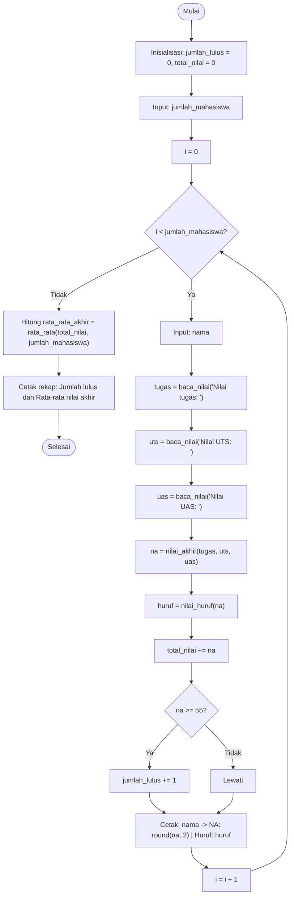

# Laporan Praktikum Week 5 — Fungsi, Parameter, dan Nilai Kembalian

## Identitas Diri
```py
Nama  = "Dendra De Tama"
NIM   = 108052600034
Kelas = "SS1SI-50-REG-01"
Dosen = "Adzanil Rachmadhi Putra"
```

---

## Deskripsi Program

Praktikum Week 5 (mengacu pada Modul Praktikum *Fungsi, Parameter, dan Nilai Kembalian*) berfokus pada modularisasi kode menggunakan fungsi di Python 3. Topik utama mencakup **definisi fungsi (`def`)**, **parameter dan argumen**, **perbedaan `return` versus `print`**, **lingkup variabel (*variable scope: local vs global*)**, **pemanfaatan modul bawaan (`math` dan `random`)**, serta **pengenalan konsep rekursi (*base case* dan *recursive case*)**.

Kumpulan program yang diimplementasikan pada praktikum ini terdiri dari:
1. **Latihan Terbimbing**:
   - `latihan1.py`: Prosedur tanpa nilai kembalian (`cetak_garis` dan `kartu_nama`) yang mendemonstrasikan pemanggilan fungsi secara berulang dan komposisi fungsi (fungsi memanggil fungsi lain).
   - `latihan2.py`: Fungsi dengan nilai kembalian (`celsius_ke_fahrenheit` dan `luas_persegi_panjang`) yang hasilnya disimpan ke dalam variabel dan digunakan dalam perhitungan aritmatika lanjutan.
   - `latihan3.py`: Penerapan `return` di dalam percabangan bersyarat (`nilai_huruf` dan fungsi predikat boolean `lulus`) yang langsung dimanfaatkan sebagai kondisi evaluasi `if`.
   - `latihan4.py`: Integrasi fungsi dari pustaka standar Python (`math.sqrt`, `math.ceil`, dan `random.randint`) di dalam fungsi kustom kalkulasi jarak Euclidean (`jarak`) dan simulasi dadu (`lempar_dadu`).
   - `latihan5.py`: Penerapan algoritma rekursif untuk perhitungan matematika faktorial (`faktorial`) dan penghitungan mundur (`hitung_mundur`) dengan identifikasi *base case* yang ketat.
2. **Studi Kasus (`studi_kasus.py`)**:
   - Program Kalkulator Nilai Akhir Mahasiswa terstruktur berbasis fungsi modular: `nilai_valid(n)` (validasi rentang 0–100), `baca_nilai(label)` (*input guard loop*), `nilai_akhir(tugas, uts, uas)` (perhitungan bobot 30%:30%:40%), `nilai_huruf(na)` (konversi grade A–D), dan tantangan tambahan `rata_rata(total, banyak)` yang terlindung dari galat pembagian dengan nol.

---

## Dekomposisi Masalah

| Sub-Masalah | Plan Pemrograman | Letak di Program | Keterangan |
| :--- | :--- | :--- | :--- |
| **Prosedur Cetak Berulang** | *Void Function / Procedure* | `latihan1.py`, baris 1–9 | Prosedur `cetak_garis()` dan `kartu_nama()` mengotomasi tata letak cetak tanpa mengembalikan nilai (`None`). |
| **Transformasi Nilai Matematis** | *Value-Returning Function (`return`)* | `latihan2.py`, baris 1–6 | Mengembalikan hasil komputasi formula agar dapat ditampung variabel atau dioperasikan ulang. |
| **Fungsi Predikat Logika Boolean** | *Boolean-Returning Predicate* | `latihan3.py`, baris 11–12 | `lulus(nilai)` mengembalikan `True` jika nilai $\ge 55$, langsung digunakan sebagai kondisi `if`. |
| **Konversi Bertingkat Melalui Return** | *Early Return Pattern* | `latihan3.py`, baris 1–8 | Evaluasi grade huruf menggunakan pemutusan eksekusi instan saat kondisi terpenuhi (`return "A"` dst). |
| **Kalkulasi Geometris & Randomisasi** | Pustaka Standar (`math` & `random`) | `latihan4.py`, baris 5–10 | Menghitung jarak Euclidean via `math.sqrt()` dan membangkitkan bilangan acak via `random.randint()`. |
| **Komputasi Rekursif Berbasis Base Case** | *Direct Recursion with Termination* | `latihan5.py`, baris 1–13 | Pemanggilan diri sendiri pada `faktorial(n-1)` dan `hitung_mundur(n-1)` yang berhenti saat $n = 0$. |
| **Validasi Domain Nilai Tertutup** | *Boundary Checker Function* | `studi_kasus.py`, baris 1–2 | `nilai_valid(n)` memastikan nilai berada pada rentang inklusif $[0, 100]$. |
| **Loop Penjaga Masukan Modular** | *Interactive Input Guard Loop* | `studi_kasus.py`, baris 5–10 | `baca_nilai()` meminta input berulang hingga `nilai_valid()` menghasilkan `True`. |
| **Kalkulasi Terbobot Komponen Nilai** | *Linear Weighted Combination* | `studi_kasus.py`, baris 13–14 | Menghitung bobot Tugas (30%), UTS (30%), dan UAS (40%). |
| **Rata-Rata Terproteksi Nol** | *Defensive Division Function* | `studi_kasus.py`, baris 28–31 | `rata_rata()` mengembalikan `0` saat penyebut bernilai nol untuk mencegah `ZeroDivisionError`. |

---

## Flowchart & Pseudocode

### Flowchart Studi Kasus (`studi_kasus.py`)



---

### Pseudocode Fungsi Penjaga Masukan & Perhitungan Nilai (`studi_kasus.py`)

```text
FUNGSI nilai_valid(n : FLOAT) -> BOOLEAN
PROSES:
    KEMBALIKAN (n >= 0 DAN n <= 100)
AKHIR FUNGSI

FUNGSI baca_nilai(label : STRING) -> FLOAT
DEKLARASI:
    nilai : FLOAT
PROSES:
    BACA nilai DENGAN PROMPT label
    SELAMA BUKAN nilai_valid(nilai) LAKUKAN
        TAMPILKAN "Nilai harus 0 sampai 100."
        BACA nilai DENGAN PROMPT label
    AKHIR SELAMA
    KEMBALIKAN nilai
AKHIR FUNGSI

FUNGSI nilai_akhir(tugas, uts, uas : FLOAT) -> FLOAT
PROSES:
    KEMBALIKAN (0.30 * tugas) + (0.30 * uts) + (0.40 * uas)
AKHIR FUNGSI

FUNGSI nilai_huruf(na : FLOAT) -> STRING
PROSES:
    JIKA na >= 85 MAKA
        KEMBALIKAN "A"
    SELAIN ITU JIKA na >= 70 MAKA
        KEMBALIKAN "B"
    SELAIN ITU JIKA na >= 55 MAKA
        KEMBALIKAN "C"
    SELAIN ITU
        KEMBALIKAN "D"
    AKHIR JIKA
AKHIR FUNGSI

ALGORITMA KalkulatorNilaiAkhirMahasiswa
MASUKAN : jumlah_mahasiswa, nama, tugas, uts, uas
KELUARAN: rincian nilai per mahasiswa, jumlah_lulus, rata_rata_akhir

PROSES:
    BACA jumlah_mahasiswa
    jumlah_lulus <- 0
    total_nilai <- 0

    UNTUK i DARI 1 SAMPAI jumlah_mahasiswa LAKUKAN
        BACA nama
        tugas <- baca_nilai("Nilai tugas: ")
        uts   <- baca_nilai("Nilai UTS: ")
        uas   <- baca_nilai("Nilai UAS: ")

        na <- nilai_akhir(tugas, uts, uas)
        huruf <- nilai_huruf(na)
        total_nilai <- total_nilai + na

        JIKA na >= 55 MAKA
            jumlah_lulus <- jumlah_lulus + 1
        AKHIR JIKA

        TAMPILKAN nama, "-> NA:", na, "| Huruf:", huruf
    AKHIR UNTUK

    TAMPILKAN "Jumlah lulus:", jumlah_lulus, "dari", jumlah_mahasiswa
    TAMPILKAN "Rata-rata nilai akhir:", rata_rata(total_nilai, jumlah_mahasiswa)
SELESAI
```

---

## Tabel Penelusuran (Trace Table)

Penelusuran manual terhadap skenario masukan `studi_kasus.py` (Data Contoh Modul Halaman 9):
- Jumlah mahasiswa: `2`
- Mahasiswa 1: Rani (Tugas = 80, UTS = 75, UAS = 90)
- Mahasiswa 2: Dimas (Tugas = 60, UTS = 120 $\to$ salah, diulang 50, UAS = 45)

| Mahasiswa ($i$) | Komponen Nilai | Validasi `nilai_valid()` | Eksekusi Rumus Nilai Akhir (NA) | Nilai Huruf | Akumulasi `total_nilai` | `jumlah_lulus` |
| :---: | :--- | :---: | :--- | :---: | :---: | :---: |
| Inisialisasi | - | - | - | - | `0` | `0` |
| 1 (Rani) | Tugas: 80, UTS: 75, UAS: 90 | Seluruh nilai Valid | $0.3(80) + 0.3(75) + 0.4(90) = \mathbf{82.5}$ | B ($70 \le 82.5 < 85$) | $0 + 82.5 = 82.5$ | $0 + 1 = 1$ |
| 2 (Dimas) | UTS: 120 | **Tidak Valid** ($> 100$) | Muncul peringatan, loop `baca_nilai()` minta ulang | - | $82.5$ | 1 |
| 2 (Dimas - ulang) | Tugas: 60, UTS: 50, UAS: 45 | Seluruh nilai Valid | $0.3(60) + 0.3(50) + 0.4(45) = \mathbf{51.0}$ | D ($51.0 < 55$) | $82.5 + 51.0 = 133.5$ | 1 (tetap) |
| **Output Akhir** | - | - | Rata-rata $= 133.5 / 2 = \mathbf{66.75}$ | - | Total: $133.5$ | **1 dari 2 Lulus** |

---

## Tabel Kasus Uji

| No | Program | Kategori Uji | Masukan (*Input*) | Hasil yang Diharapkan (*Expected*) | Hasil Aktual Program (*Actual*) | Status |
| :---: | :--- | :--- | :--- | :--- | :--- | :---: |
| 1 | `latihan1.py` | **Prosedur** | `kartu_nama("Rani", ...)` | 2 blok kartu nama dibatasi 30 tanda `=` | Sesuai output modul | PASS |
| 2 | `latihan2.py` | **Fungsi Return**| suhu = 30 | Fahrenheit: 86.0<br>Luas kamar: 12, Luas dapur: 6<br>Total luas: 18 | Sesuai output modul | PASS |
| 3 | `latihan3.py` | **Nilai Batas** | nilai = 90, 72, 40 | 90 -> A \| Lulus<br>72 -> B \| Lulus<br>40 -> D \| Tidak lulus | Sesuai output modul | PASS |
| 4 | `latihan4.py` | **Modul Math** | `jarak(0, 0, 3, 4)` | Jarak A ke B: 5.0<br>Jarak C ke D dibulatkan: 6 | Sesuai output modul | PASS |
| 5 | `latihan4.py` | **Modul Random**| `lempar_dadu()` | 3 nilai acak bilangan bulat dalam interval $[1, 6]$ | Sesuai output modul | PASS |
| 6 | `latihan5.py` | **Rekursi Faktorial**| $n = 5$ | `5! = 120` ($5 \times 4 \times 3 \times 2 \times 1$) | Sesuai output modul | PASS |
| 7 | `latihan5.py` | **Rekursi Hitung Mundur**| $n = 3$ | `3, 2, 1, Mulai!` | Sesuai output modul | PASS |
| 8 | `studi_kasus.py` | **Normal Sesuai Modul**| 2 mhs: Rani (80, 75, 90), Dimas (60, 120$\to$50, 45) | Rani NA: 82.5 (B), Dimas NA: 51.0 (D)<br>Lulus: 1 dari 2, Rata-rata: 66.75 | Sesuai output modul | PASS |
| 9 | `studi_kasus.py` | **Zero Division Guard**| jumlah_mahasiswa = 0 | `rata_rata()` mengembalikan 0 tanpa crash galat | `0.0` | PASS |

---

## Catatan Pertanyaan Modul & Analisis Galat

### Jawaban Pertanyaan Praktik Modul:
1. **Latihan 1**: Jika argumen `cetak_garis(30)` diubah menjadi `cetak_garis(20)`, berapa baris kode yang perlu diubah agar kedua kartu nama ikut berubah?
   - *Jawaban*: Cukup **2 baris** saja, yaitu dua pemanggilan `cetak_garis(20)` yang berada di dalam badan fungsi `kartu_nama()`. Kedua kartu nama yang dicetak ("Rani" dan "Dimas") otomatis berubah panjang garisnya tanpa harus mengubah baris kode pemanggilan fungsi utama. Ini mendemonstrasikan keunggulan *maintainability* fungsi.
2. **Latihan 2**: Mengapa hasil pemanggilan fungsi `luas_persegi_panjang` dapat langsung dijumlahkan?
   - *Jawaban*: Karena fungsi tersebut memakai pernyataan `return`, yang mengirimkan kembali nilai hasil perhitungan ke baris pemanggil. Jika fungsi hanya menggunakan perintah `print()`, fungsi tersebut mengembalikan nilai bawaan `None` yang akan memicu galat `TypeError` jika dijumlahkan.
3. **Latihan 3**: Apa keunggulan fungsi predikat seperti `lulus(nilai)`?
   - *Jawaban*: Fungsi tersebut mengembalikan tipe data boolean (`True` atau `False`), sehingga pemanggilannya dapat langsung diletakkan sebagai ekspresi kondisi pada struktur percabangan `if lulus(n):` secara ekspresif tanpa perlu membandingkan manual `== True`.
4. **Latihan 4**: Mengapa hasil `jarak` selalu konsisten sementara `lempar_dadu` berubah-ubah?
   - *Jawaban*: Fungsi `jarak` merupakan fungsi murni (*pure/deterministic function*) yang perhitungannya hanya bergantung pada argumen koordinat matematis. Sebaliknya, fungsi `lempar_dadu` memanfaatkan fungsi pembangkit pseudo-acak `random.randint()` sehingga nilai kembaliannya bersifat stokastik di setiap eksekusi.
5. **Latihan 5**: Apa yang terjadi jika *base case* pada `hitung_mundur` dihapus?
   - *Jawaban*: Fungsi akan memanggil dirinya sendiri secara terus-menerus menuju nilai negatif tanpa kondisi henti hingga batas memori tumpukan eksekusi terlampaui, menyebabkan Python berhenti seketika dengan galat `RecursionError: maximum recursion depth exceeded`.

### Analisis Galat Teknis:
1. **Galat Lingkup Variabel Lokal (*UnboundLocalError / NameError*)**:
   - *Penyebab*: Mencoba membaca atau mencetak variabel yang dideklarasikan di dalam badan fungsi (variabel lokal) dari luar lingkup fungsi tersebut.
   - *Perbaikan*: Melewatkan data melalui parameter fungsi dan mengambil nilai keluarannya melalui kata kunci `return`.
2. **Galat Pembagian dengan Nol (*ZeroDivisionError*)**:
   - *Penyebab*: Memanggil fungsi kalkulasi rata-rata `total / banyak` saat jumlah mahasiswa bernilai `0`.
   - *Perbaikan*: Memasang *guard condition* di dalam fungsi `rata_rata()`: `if banyak == 0: return 0`.

---

## Refleksi

Praktikum Week 5 memberikan lonjakan kualitas perancangan algoritma dari paradigma sekuensial prosedural menuju paradigma modular. Memecah program menjadi fungsi-fungsi kecil dengan tanggung jawab tunggal (*Single Responsibility Principle*) terbukti membuat kode program jauh lebih terstruktur, mudah diuji secara independen, dan meminimalkan duplikasi baris kode (*Don't Repeat Yourself*).

Pemahaman terhadap perbedaan mendasar antara `print` (penyajian informasi untuk manusia) dan `return` (penyerahan data komputasi untuk program) menjadi fondasi krusial dalam menyusun alur pengolahan data yang saling tersambung. Selain itu, pemahaman tentang rekursi mengajarkan pentingnya merancang *base case* yang solid agar pemanggilan rekursif terjamin berhenti secara aman.

---

## Pengungkapan Penggunaan AI

- **Bagian yang Dibantu AI**:
  - Perancangan bagan alir (*flowchart*) Mermaid yang menggambarkan integrasi perulangan program utama dan modularitas pemanggilan fungsi pembantu.
  - Penyusunan pseudocode dan tabel penelusuran (*trace table*) yang disesuaikan secara presisi dengan contoh data pengujian modul.
  - Perumusan jawaban sistematis terhadap pertanyaan panduan dari Modul Praktikum.
- **Saran AI yang Dipakai**:
  - Penambahan *zero-division guard* di dalam fungsi `rata_rata(total, banyak)` untuk menyelesaikan tantangan tambahan studi kasus secara aman.
  - Pemanfaatan *early return* pada fungsi `nilai_huruf()` untuk mempersingkat alur percabangan tanpa perlu `else` bertingkat yang redundan.
- **Saran AI yang Ditolak & Alasannya**:
  - Penulisan fungsi lambda (*anonymous function*), ditolak agar struktur fungsi tetap konsisten menggunakan sintaks formal `def` sesuai modul.
